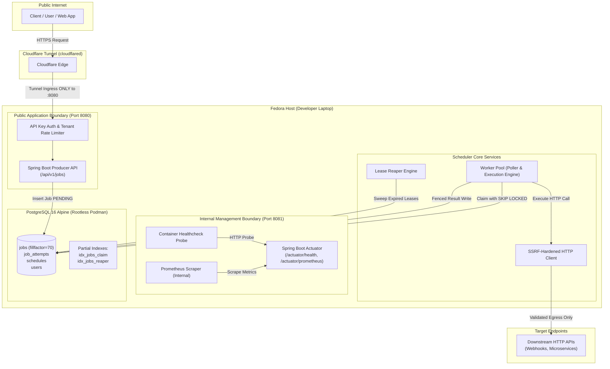
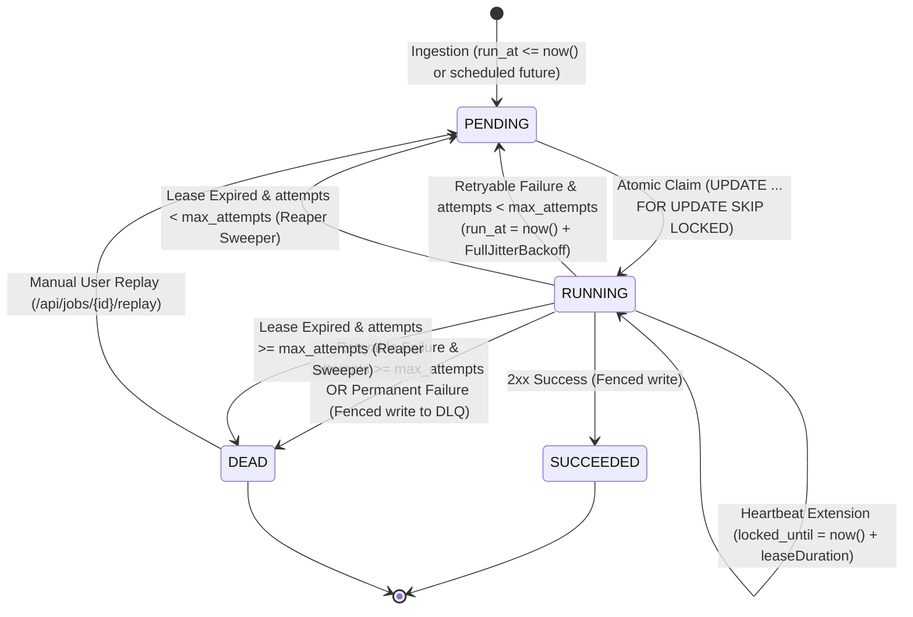
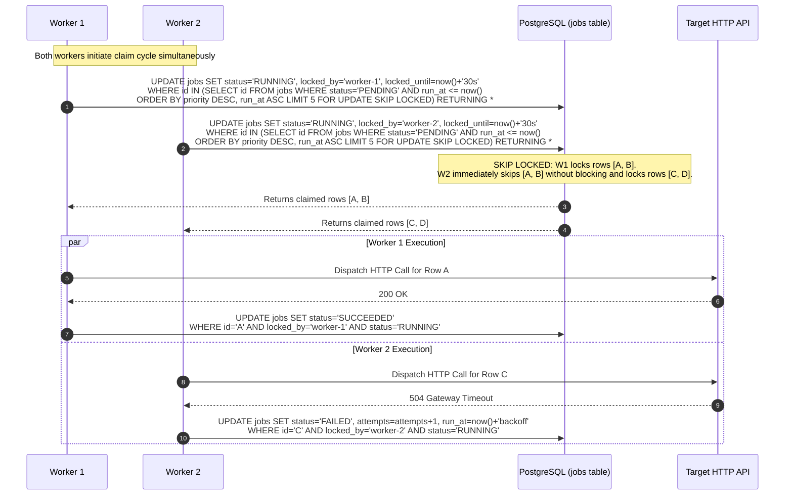
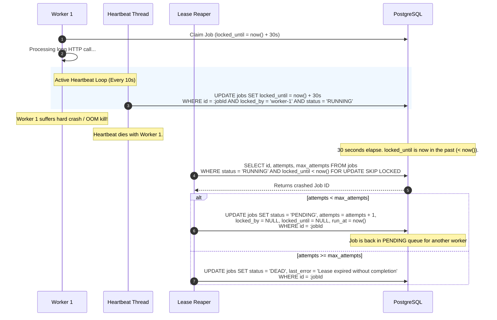
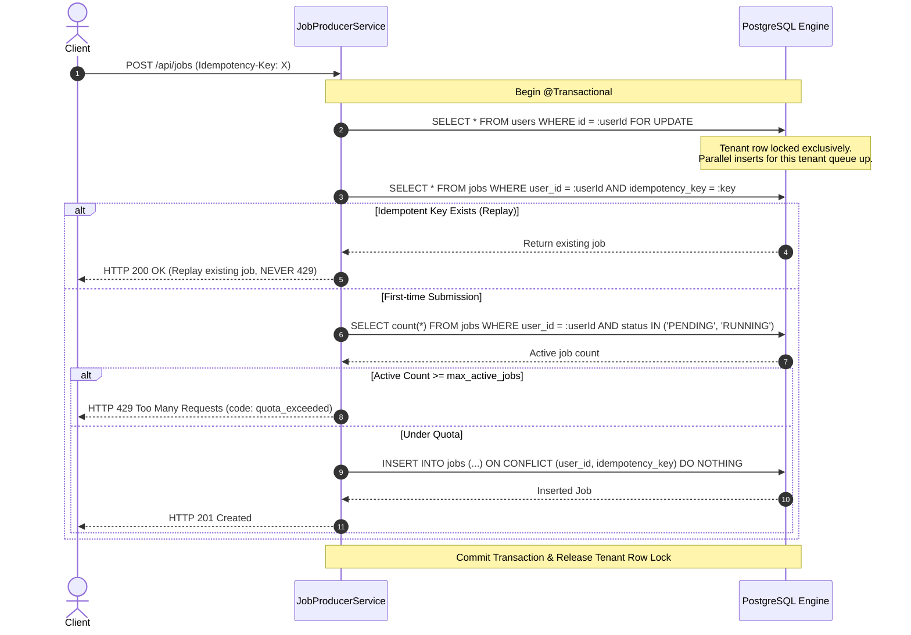

# Reliable HTTP Job Scheduler — Architecture & Technical Design Document

> **Document Version:** 1.7.0 (Phase 8 Recurring Cron Schedules)  
> **Status:** Active / Under Iterative Development  
> **Target Audience:** Engineering Mentors, Backend System Designers, Technical Interviewers  

---

## Table of Contents
1. [Mission & Problem Statement](#1-mission--problem-statement)
2. [Core Concept Definitions ("What Everything Is")](#2-core-concept-definitions-what-everything-is)
3. [System Architecture & Visual Diagrams](#3-system-architecture--visual-diagrams)
   - [3.1 High-Level Topology & Port Isolation](#31-high-level-topology--port-isolation)
   - [3.2 State Machine & Job Lifecycle](#32-state-machine--job-lifecycle)
   - [3.3 Atomic Claim & Concurrency Protocol](#33-atomic-claim--concurrency-protocol)
   - [3.4 Worker Execution & Off-Transaction Model](#34-worker-execution--off-transaction-model)
   - [3.5 Lease Expiry, Heartbeat & Reaper Protocol](#35-lease-expiry-heartbeat--reaper-protocol)
4. [Deep-Dive Architecture Choices & Trade-Offs](#4-deep-dive-architecture-choices--trade-offs)
   - [4.1 Primary Key Selection: UUIDv7 vs UUIDv4](#41-primary-key-selection-uuidv7-vs-uuidv4)
   - [4.2 Payload Config (JSONB) vs Verbatim Body (TEXT)](#42-payload-config-jsonb-vs-verbatim-body-text)
   - [4.3 Database Type Safety: VARCHAR + CHECK vs Native ENUM](#43-database-type-safety-varchar--check-vs-native-enum)
   - [4.4 Indexing Strategy: Partial Indexes vs Full Composite B-Trees](#44-indexing-strategy-partial-indexes-vs-full-composite-b-trees)
   - [4.5 Single Clock Authority (`now()` in SQL vs Application Clocks)](#45-single-clock-authority-now-in-sql-vs-application-clocks)
   - [4.6 Database Bloat & Autovacuum Plan (HOT Updates & fillfactor = 70)](#46-database-bloat--autovacuum-plan-hot-updates--fillfactor--70)
   - [4.7 Rootless Podman on Fedora (SELinux :Z & Systemd Auto-Restart)](#47-rootless-podman-on-fedora-selinux-z--systemd-auto-restart)
   - [4.8 API Authentication & API Key Strategy](#48-api-authentication--api-key-strategy)
   - [4.9 Idempotency Implementation: In-Transaction DB Row vs Redis](#49-idempotency-implementation-in-transaction-db-row-vs-redis)
   - [4.10 Request Body Format & Binary Limitation](#410-request-body-format--binary-limitation)
   - [4.11 Input Validation & SSRF Disclaimer](#411-input-validation--ssrf-disclaimer)
   - [4.12 Sensitive Data Logging Policy](#412-sensitive-data-logging-policy)
   - [4.13 Worker Threading Model: Platform Thread Pool vs Java 21 Virtual Threads + Semaphore](#413-worker-threading-model-platform-thread-pool-vs-java-21-virtual-threads--semaphore)
   - [4.14 Atomic Claim Query & Plan Verification](#414-atomic-claim-query--plan-verification)
   - [4.15 Off-Transaction Handler Execution & Hikari Pool Sizing](#415-off-transaction-handler-execution--hikari-pool-sizing)
   - [4.16 Fencing Token Guard Against Zombie Workers](#416-fencing-token-guard-against-zombie-workers)
   - [4.17 Handler Contract & Extensibility](#417-handler-contract--extensibility)
   - [4.18 Exponential Backoff with Full Jitter Formula & Math](#418-exponential-backoff-with-full-jitter-formula--math)
   - [4.19 Dead-Letter Queue (DLQ) & Terminal Failure Semantics](#419-dead-letter-queue-dlq--terminal-failure-semantics)
   - [4.20 Lease Reaper Architecture & Multi-Instance Skip-Locked Sweeper](#420-lease-reaper-architecture--multi-instance-skip-locked-sweeper)
   - [4.21 Heartbeat Protocol & AutoCloseable Resource Management](#421-heartbeat-protocol--autocloseable-resource-management)
   - [4.22 Graceful Shutdown Protocol](#422-graceful-shutdown-protocol)
   - [4.23 HTTP Client Selection & Virtual Thread Unmounting (`java.net.http.HttpClient`)](#423-http-client-selection--virtual-thread-unmounting-javanethttphttpclient)
   - [4.24 HTTP Status Code Classification: 2xx, 429 & 5xx, vs 4xx Client Errors](#424-http-status-code-classification-2xx-429--5xx-vs-4xx-client-errors)
   - [4.25 Audit Logging & Database Bloat Mitigation: Response Truncation (4 KB Snippet)](#425-audit-logging--database-bloat-mitigation-response-truncation-4-kb-snippet)
   - [4.26 Handling Non-JSON & Text-Only Webhook Payloads](#426-handling-non-json--text-only-webhook-payloads)
   - [4.27 OkHttp Migration & Single-Resolution DNS Pinning Invariant (`okhttp3.Dns`)](#427-okhttp-migration--single-resolution-dns-pinning-invariant-okhttp3dns)
   - [4.28 OkHttp Network Interceptor Wire Guard for IP-Literal Hosts](#428-okhttp-network-interceptor-wire-guard-for-ip-literal-hosts)
   - [4.29 Authoritative Default-Deny IP Range Engine & IPv6 2000::/3 Space](#429-authoritative-default-deny-ip-range-engine--ipv6-20003-space)
   - [4.30 Secure Manual Redirect Loop, Cross-Origin Header Stripping & Port Allowlist](#430-secure-manual-redirect-loop-cross-origin-header-stripping--port-allowlist)
   - [4.31 Multi-Tenant Concurrency Quotas (`max_active_jobs`) & Pessimistic Locking](#431-multi-tenant-concurrency-quotas-max_active_jobs--pessimistic-locking)
   - [4.32 In-Memory CAS Token Bucket Rate Limiting & Per-Instance Scope](#432-in-memory-cas-token-bucket-rate-limiting--per-instance-scope)
   - [4.33 Machine-Readable Error Contract (`rate_limited` vs `quota_exceeded`) & Dashboard Usage Endpoint](#433-machine-readable-error-contract-rate_limited-vs-quota_exceeded--dashboard-usage-endpoint)
   - [4.34 Dedicated API Key Lifecycle, Scope Limitations & Throttled Usage Tracking](#434-dedicated-api-key-lifecycle-scope-limitations--throttled-usage-tracking)
   - [4.35 Recurring Cron Blueprint Architecture & Separation from Execution Instances](#435-recurring-cron-blueprint-architecture--separation-from-execution-instances)
   - [4.36 Misfire Recovery Protocol (`FIRE_ONCE` vs `SKIP`), Grace Windows & Downtime Thundering Herd Defense](#436-misfire-recovery-protocol-fire_once-vs-skip-grace-windows--downtime-thundering-herd-defense)
   - [4.37 Global Lock Hierarchy Invariant (`Schedule -> Tenant -> Job`) & Zero-Deadlock Guarantee](#437-global-lock-hierarchy-invariant-schedule---tenant---job--zero-deadlock-guarantee)
   - [4.38 Timezone Semantics, IANA Validation & Daylight Saving Time (DST) Transitions](#438-timezone-semantics-iana-validation--daylight-saving-time-dst-transitions)
   - [4.39 Poison Schedule Isolation, Auto-Disable Failure Tracking & Circuit Breaking](#439-poison-schedule-isolation-auto-disable-failure-tracking--circuit-breaking)
   - [4.40 Partial Indexing for $O(1)$ Overlap Checks (`idx_jobs_schedule_active`) & EXPLAIN Benchmark](#440-partial-indexing-for-o1-overlap-checks-idx_jobs_schedule_active--explain-benchmark)
5. [What Went Wrong & Engineering Resolutions](#5-what-went-wrong--engineering-resolutions)
6. [Repository Exclusion Policy (.gitignore)](#6-repository-exclusion-policy-gitignore)
7. [Comprehensive Interview Defense & Technical Questions](#7-comprehensive-interview-defense--technical-questions)

---

## 1. Mission & Problem Statement

### The Problem
Modern web backends regularly need to invoke external HTTP endpoints asynchronously:
- *"Send this webhook in 10 minutes."*
- *"Sync customer data with external CRM every morning at 03:00 UTC."*
- *"Dispatch this notification to an external gateway, retry with backoff if their server is down, and tell me what happened."*

Traditional solutions usually involve managed services (e.g., Upstash QStash, AWS EventBridge Scheduler, Google Cloud Tasks) or heavyweight distributed infrastructure (Kafka + Debezium, RabbitMQ, Celery, Redis BullMQ). For small-to-medium systems, standalone SaaS sites, or developer laptops, operating a Kafka cluster or paying per-request SaaS pricing introduces unnecessary operational complexity, unpredictable cloud bills, or network dependencies.

### What We Are Achieving
We are building a **self-hosted, production-grade, PostgreSQL-backed reliable HTTP job scheduler** paired with a live monitoring dashboard. It allows clients to submit HTTP requests (method, target URL, headers, and body) to run either:
1. **Immediately / Delayed**: Executed after a specified delay (`run_at`).
2. **Recurring**: Executed on a standard cron expression.

When requests fail due to downstream timeouts, 5xx server errors, or network hiccups, the engine retries them using exponential backoff with full jitter. Jobs exceeding maximum retry attempts land in a **Dead Letter Queue (DLQ)**, where they are preserved with full diagnostic history and can be inspected or replayed.

### Honest Scope & Anti-Goals
- **This is NOT Kafka-scale**: We do not claim 500,000 writes/second or infinite log streaming. Claiming Kafka-scale on top of relational RDBMS queues is an interview anti-pattern.
- **This IS a resilient, at-least-once, lease-governed relational queue**: Designed to process tens of thousands of jobs per hour with zero message loss, zero external broker dependencies, ACID transactional integrity, and strong concurrency guarantees using native PostgreSQL row locks (`SKIP LOCKED`).

---

## 2. Core Concept Definitions ("What Everything Is")

To defend this architecture in an interview, every term must be understood down to its engine-level mechanics:

| Concept                          | Technical Definition                                                                                                                                       | Why It Exists in Our System                                                                                                                                                                                              |
| :------------------------------- | :--------------------------------------------------------------------------------------------------------------------------------------------------------- | :----------------------------------------------------------------------------------------------------------------------------------------------------------------------------------------------------------------------- |
| **Job**                          | A single persistent unit of work representing an outbound HTTP call, including metadata, execution schedule, current status, and retry state.              | The primary entity tracked in the `jobs` table.                                                                                                                                                                          |
| **At-Least-Once Delivery**       | A guarantee that every scheduled job will be executed at least one time, but in rare network or crash scenarios might be executed more than once.          | Network partitions or worker crashes during HTTP completion can cause leases to expire before the worker updates status. Handlers must therefore be idempotent.                                                          |
| **Idempotency Key**              | A unique per-user client token submitted during job creation.                                                                                              | Enforced by a partial unique index `(user_id, idempotency_key)`. If a network glitch causes a client to submit the same POST twice, the engine returns the existing job with `200 OK` rather than duplicating execution. |
| **Worker Lease**                 | A time-limited lock (`locked_by`, `locked_until`) acquired by a worker when claiming a job.                                                                | Prevents other workers from executing the same job concurrently while allowing automatic reclamation if the assigned worker crashes.                                                                                     |
| **Heartbeat**                    | A background worker thread that periodically extends `locked_until = now() + INTERVAL` for long-running HTTP requests.                                     | Ensures long jobs don't get prematurely reclaimed by the reaper while the worker is actively waiting for a slow downstream server.                                                                                       |
| **Lease Reaper**                 | A scheduled background sweeper that detects orphaned jobs whose `locked_until < now()` and requeues or fails them.                                         | Recovers from hard worker crashes (e.g., node power failure, OS kernel panic, or OOM kill) without human intervention.                                                                                                   |
| **Fencing Token / Lease Guard**  | Guarding completion writes by `WHERE id = :id AND locked_by = :workerId AND status = 'RUNNING'`.                                                           | Solves the "zombie worker" problem: if a worker experiences a 60-second GC pause and its lease was reassigned, its stale write fails safely (0 rows affected).                                                           |
| **Dead Letter Queue (DLQ)**      | A terminal state (`status = 'DEAD'`) for jobs that have exhausted all retry attempts without succeeding.                                                   | Prevents failed jobs ("poison pills") from perpetually clogging queue throughput while preserving the failure snippet for debugging and manual replay.                                                                   |
| **Exponential Backoff + Jitter** | Retry delay formula: $\text{delay} = \min(\text{cap}, \text{base} \cdot 2^{\text{attempt}}) \pm \text{random_jitter}$.                                     | Prevents the "thundering herd" problem where hundreds of retrying jobs hammer an already struggling downstream API simultaneously.                                                                                       |
| **HOT (Heap-Only Tuple) Update** | A PostgreSQL optimization where an updated row version is placed on the exact same 8 KB data page as the old version without modifying any index pointers. | Drastically reduces table and index write amplification on update-heavy queue rows. Enabled by setting `fillfactor = 70`.                                                                                                |

---

## 3. System Architecture & Visual Diagrams

### 3.1 High-Level Topology & Port Isolation

Public internet access is strictly limited to the Producer REST API behind Cloudflare Tunnel. Actuator and internal management endpoints live on a physically distinct port that is never forwarded.



---

### 3.2 State Machine & Job Lifecycle

A job moves through an explicit state machine with strict database constraints:



---

### 3.3 Atomic Claim & Concurrency Protocol

Multiple worker threads and multiple application instances poll concurrently without locking each other or double-claiming rows.



---

### 3.4 Lease Expiry, Heartbeat & Reaper Protocol

This diagram illustrates how heartbeats protect long jobs while the reaper reclaims abandoned jobs from crashed workers without race conditions.



---

## 4. Deep-Dive Architecture Choices & Trade-Offs

### 4.1 Primary Key Selection: UUIDv7 vs UUIDv4
*(Defended purely on database index B-Tree physical layout and buffer cache mechanics.)*

- **The Flaw of UUIDv4**:
  UUIDv4 generates 128 pseudo-random bits. A B-Tree index maintains keys in sorted order. When inserting random UUIDv4 keys into a table with millions of rows, each new key lands in an arbitrary leaf page scattered throughout the B-Tree.
  - As soon as the index exceeds PostgreSQL's `shared_buffers` cache, each insert causes a random read from disk to pull the target page into RAM, followed by a dirty write back to disk.
  - When a target leaf page is full, PostgreSQL must perform a **50/50 page split**: it allocates a new 8 KB block, moves half the tuples to the new block, and updates parent nodes. This causes high write amplification and leaves index pages with an average fill factor of ~50%, doubling physical storage.
- **The Efficiency of UUIDv7 (RFC 9562)**:
  UUIDv7 begins with a 48-bit big-endian millisecond timestamp, followed by version bits and 74 random bits.
  - Because timestamp values strictly increase over time, successive keys are monotonically ordered.
  - Every `INSERT` targets the **right-most leaf page** of the B-Tree index (right-edge append).
  - Leaf pages fill to near 100% capacity before a clean right-edge split allocates the next page.
  - Only the newest leaf page needs to stay resident in cache, yielding near 100% cache hit ratios and identical insertion performance to an auto-incrementing `BIGINT`, while preserving global uniqueness.

---

### 4.2 Payload Config (JSONB) vs Verbatim Body (TEXT)

- **`payload JSONB`**:
  Contains configuration parameters that our scheduling engine must interpret:
  ```json
  {
    "url": "https://api.example.com/v1/webhooks",
    "method": "POST",
    "headers": {
      "Content-Type": "application/json",
      "X-Custom-Header": "production-event"
    },
    "timeout_ms": 5000
  }
  ```
- **`body TEXT`**:
  Stores the exact HTTP request body verbatim.
- **Why NOT round-trip the body through JSONB?**
  1. **Canonicalization alters byte signatures**: `JSONB` parses JSON into an internal binary tree. It reorders keys alphabetically, strips extraneous whitespace, collapses multi-line formatting, and drops duplicate object keys. If the downstream API verifies an HMAC signature (e.g., Stripe, GitHub, or Shopify webhook verification) computed over raw bytes, JSONB round-tripping breaks signature verification.
  2. **Non-JSON compatibility**: Jobs can deliver raw text, XML documents, CSV files, GraphQL queries, SOAP envelopes, or form-urlencoded strings. Storing `body TEXT` accepts any payload format without rejection.

---

### 4.3 Database Type Safety: VARCHAR + CHECK vs Native ENUM

- **The Problem with Postgres `CREATE TYPE job_status AS ENUM (...)`**:
  - In PostgreSQL, altering a native enum type (adding values inside transactions, reordering, or deprecating values) historically required schema-level exclusive catalog locks (`pg_type`).
  - Native enums create tight coupling with ORM frameworks (Hibernate/JPA often requires proprietary PostgreSQL dialect mappings).
  - Rolling back migrations involving enum alterations is notoriously difficult in Flyway.
- **The Solution: `VARCHAR(20) CHECK (status IN (...))`**:
  - 100% database-enforced integrity (invalid strings are rejected immediately with a constraint violation).
  - Adding a new status in a future migration is a non-blocking `ALTER TABLE jobs DROP CONSTRAINT ...` and `ALTER TABLE jobs ADD CONSTRAINT ... NOT VALID` followed by `VALIDATE CONSTRAINT`.
  - Maps transparently to Java `@Enumerated(EnumType.STRING)` without custom type binders.

---

### 4.4 Indexing Strategy: Partial Indexes vs Full Composite B-Trees

A typical job queue follows an extreme lifecycle:
$$\text{Pending (short)} \longrightarrow \text{Running (seconds)} \longrightarrow \text{Succeeded / Dead (permanent)}$$
Over weeks of operation, a table might hold 5,000,000 total rows, of which only 150 are `PENDING` and 10 are `RUNNING`.

- **Anti-Pattern (Full Index)**:
  `CREATE INDEX idx_jobs ON jobs (status, priority, run_at);`
  - Maintains pointers to all 5,000,000 completed rows.
  - The index swells to hundreds of megabytes, forcing disk I/O on every worker claim poll.
- **Our Pattern (Partial Indexes)**:
  ```sql
  -- Claim Index: Only indexes active work candidates
  CREATE INDEX idx_jobs_claim ON jobs (priority DESC, run_at ASC)
      WHERE status = 'PENDING';

  -- Reaper Index: Only indexes active leases
  CREATE INDEX idx_jobs_reaper ON jobs (locked_until ASC)
      WHERE status = 'RUNNING';
  ```
  - As soon as a row changes to `RUNNING` or `SUCCEEDED`, PostgreSQL automatically prunes it from `idx_jobs_claim`.
  - The index remains a few kilobytes in size, fitting permanently into CPU L2/L3 cache or `shared_buffers`.

---

### 4.5 Single Clock Authority (`now()` in SQL vs Application Clocks)

In a distributed deployment with multiple worker containers across laptops or servers, local system clocks can drift due to NTP skew, hardware variance, or VM virtualization pauses.
- If Worker A has a clock skewed +5 seconds ahead of Worker B, Worker A might claim a lease or determine a job is due before Worker B.
- **Design Rule**: All temporal evaluation (`run_at <= now()`, `locked_until = now() + INTERVAL '30 seconds'`, `locked_until < now()`) is strictly computed inside PostgreSQL using `now()`. Worker JVMs never pass client timestamps into query WHERE clauses for scheduling logic.

---

### 4.6 Database Bloat & Autovacuum Plan (HOT Updates & fillfactor = 70)

Because PostgreSQL uses Multiversion Concurrency Control (MVCC), an `UPDATE` does not overwrite data in place; it writes a new version of the row (tuple) and marks the old version as dead. A queue table where rows transition `PENDING` $\to$ `RUNNING` $\to$ `HEARTBEAT` $\to$ `SUCCEEDED` will accumulate dead tuples at 3x to 5x the rate of insertions.

#### HOT (Heap-Only Tuple) Optimization
- If an update does not change any indexed column, and the data page has enough spare capacity, Postgres places the new tuple on the same 8 KB page and creates a page-internal pointer chain.
- No index update is incurred, and normal reads prune dead tuple versions on the fly.
- By default, tables have `fillfactor = 100` (packed full on insert). In [V1__initial_schema.sql](file:///home/ashutosh/Desktop/job-scheduler/backend/src/main/resources/db/migration/V1__initial_schema.sql), we configure:
  ```sql
  ALTER TABLE jobs SET (
      fillfactor = 70,                        -- Reserves 30% page space for in-place HOT updates
      autovacuum_vacuum_scale_factor = 0.02,  -- Trigger vacuum after 2% row churn (vs default 20%)
      autovacuum_vacuum_threshold = 100,      -- Or at least 100 dead rows
      autovacuum_vacuum_cost_limit = 1000,    -- 5x higher I/O budget for vacuum sweeps
      autovacuum_vacuum_cost_delay = 2        -- Fast 2ms throttle delay
  );
  ```

---

### 4.7 Rootless Podman on Fedora (SELinux :Z & Systemd Auto-Restart)

#### The SELinux `:Z` Requirement
On Fedora, rootless containers execute inside the SELinux `container_t` domain. Host filesystem directories (like `./postgres_data`) are labeled `user_home_t`.
- When PostgreSQL attempts to initialize the database in a standard bind-mount, SELinux blocks container process writes with `Permission Denied`.
- Appending the `:Z` flag (`./postgres_data:/var/lib/postgresql/data:Z`) instructs Podman to automatically relabel the directory with a private unshared container context (`system_u:object_r:container_file_t:s0:c...`), allowing PostgreSQL full read/write access.

#### Auto-Restarting Across Reboots on Fedora
Rootless containers belong to user systemd sessions (`/run/user/$UID`), which do not start at system boot unless configured:
1. **Enable Systemd Lingering**:
   ```bash
   loginctl enable-linger $USER
   ```
   Ensures the systemd user manager starts at system boot and remains running even when no interactive terminal session is active.
2. **Enable Podman Restart Service**:
   ```bash
   systemctl --user enable --now podman-restart.service
   ```
   This service queries Podman's state database on system boot and restarts all containers marked with `restart: unless-stopped`.

---

### 4.8 Dedicated API Keys Architecture & Rotation
Instead of storing a single static key hash on the `users` table, Phase 2 implements a separate `api_keys` relation (`api_keys(id, user_id, key_hash, key_prefix, created_at, revoked_at, last_used_at)`):
- **High Entropy Generation**: Keys are generated using `SecureRandom` with 32 bytes (256 bits) of cryptographic entropy, encoded via URL-safe Base64 (`sk_live_...`).
- **No Keys in Migrations**: Migrations define the schema only. Initial development keys are provisioned via a non-production `DevBootstrapRunner` (`@Profile("!test")`), which logs the issued secret key exactly once on startup.
- **Hash Storage & Lookups**: Only the SHA-256 hex digest (`key_hash`) is persisted. The `key_prefix` (e.g. `sk_live_a1b2c3d4`) is stored in plaintext solely for user identification in management UIs.
- **Revocation**: Key revocation is supported via `revoked_at TIMESTAMPTZ`. A partial index on `key_hash WHERE revoked_at IS NULL` guarantees lookups ignore revoked credentials.

---

### 4.9 Atomic Idempotency Protocol with Request Hashing
When clients submit requests with an `idempotency_key` (via the `Idempotency-Key` HTTP header or JSON field `idempotencyKey`):
1. **Header vs JSON Agreement**: If both the header and JSON body specify an idempotency key and they disagree, the request is immediately rejected with `400 Bad Request`.
2. **Atomic Conflict Insertion**:
   ```sql
   INSERT INTO jobs (
       id, user_id, queue, type, payload, body, status,
       priority, run_at, attempts, max_attempts, idempotency_key,
       request_hash, created_at, updated_at
   )
   VALUES (?, ?, ?, 'HTTP', ?::jsonb, ?, 'PENDING', ?, ?, 0, ?, ?, ?, now(), now())
   ON CONFLICT (user_id, idempotency_key) WHERE idempotency_key IS NOT NULL
   DO NOTHING
   RETURNING id;
   ```
3. **Canonical Request Hashing & 409 Conflict Semantics**:
   - Every request computes a canonical SHA-256 hash of `METHOD\nURL\n[sorted header_k:header_v\n]\nBODY`.
   - If `ON CONFLICT` returns 0 rows (the key was already used), the service loads the existing job:
     - **Hashes Match**: Returns `200 OK` with the existing job response and an `Idempotent-Replayed: true` HTTP header.
     - **Hashes Differ**: The client reused the same idempotency key for a distinct request. Returns `409 Conflict` (`"Idempotency key was previously submitted with a different request payload"`).

---

### 4.10 Data Access Strategy: JPA vs JdbcTemplate
- **Spring Data JPA**: Used for domain entities, standard CRUD operations, user/key lookups, and paginated listing.
- **Native SQL / JdbcTemplate**: Used specifically for the atomic `INSERT ... ON CONFLICT (user_id, idempotency_key) DO NOTHING RETURNING id` query and the Phase 3 worker claim query (`FOR UPDATE SKIP LOCKED`).
  - *Rationale*: JPA / Hibernate lacks native support for PostgreSQL's `ON CONFLICT DO NOTHING RETURNING *` clause and `SKIP LOCKED` batch updates without risking lock escalation or ORM session caching inconsistencies.
  - *Hibernate Configuration*: `spring.jpa.hibernate.ddl-auto` is set to `validate` to ensure Flyway remains the single source of truth for the database schema.

---

### 4.11 Ingestion Validation & Security Invariants
- **CRLF Rejection**: Inbound header names and values are inspected for carriage return (`\r`) and line feed (`\n`) characters to prevent HTTP response splitting and header injection.
- **Forbidden Headers**: Rejects client attempts to specify `Host`, `Content-Length`, `Transfer-Encoding`, `Connection`, or any header starting with `Proxy-*`.
- **Payload Constraints**:
  - URL length capped at 2,048 characters.
  - Header count capped at 50 entries.
  - Priority bounded between 0 and 10 (inclusive).
  - Schedule `runAt` bounded to at most 365 days into the future.
  - Body support is **UTF-8 text only** (capped at 64 KB, rejecting binary NUL bytes `\0`).
- **SSRF Note in Code**: URL syntax validation (`URI.create`, scheme checks) verifies string structure only. It is **not** SSRF protection; SSRF defense is strictly performed during job execution in Phase 6 via pre-resolution IP validation.

---

### 4.12 Sensitive Data Logging Policy
Application logs strictly record operational identifiers: `jobId`, `userId`, `queue`, `priority`, and high-level outcomes. **Headers and request/response bodies are never logged** to prevent leaking sensitive API tokens, bearer credentials, passwords, or PII.

---

### 4.13 Worker Threading Model: Platform Thread Pool vs Java 21 Virtual Threads + Semaphore

#### The Architectural Decision
A core design question for a job scheduler is how worker concurrency is managed:
1. **Option A: Traditional Fixed Platform Thread Pool (`ThreadPoolExecutor`)**
   - *Mechanics*: Each worker concurrency slot maps 1:1 to an operating system kernel thread (typically 1 MB native stack per thread).
   - *Pros*: Predictable resource bounds; familiar debugging tools; thread-local storage isolation.
   - *Cons*: OS thread allocation is heavy. When an HTTP job blocks waiting for a slow downstream server (e.g., 10–30 second timeouts), the kernel thread remains parked and idle, consuming OS memory and context-switching cycles. Scaling to 1,000 concurrent jobs requires ~1 GB of native stack memory alone.
2. **Option B: Java 21 Virtual Threads + `Semaphore` Concurrency Limiter (OUR PICK)**
   - *Mechanics*: Each claimed job is dispatched onto a Java 21 Virtual Thread via `Executors.newVirtualThreadPerTaskExecutor()`. Global worker concurrency is strictly bounded by a `java.util.concurrent.Semaphore`.
   - *Pros*:
     - Virtual threads are ultra-lightweight JVM user-mode threads (~few hundred bytes initial memory).
     - When blocking on network I/O or sleep, the virtual thread is unmounted from its underlying carrier thread (ForkJoinPool worker), freeing CPU cores completely.
     - Concurrency is explicitly bounded: `semaphore.availablePermits()` directly dictates how many jobs the poller claims from PostgreSQL in each iteration.
     - Eliminates connection starvation and platform thread exhaustion.
   - *Cons*: Pinning caveats if code synchronizes on native monitors (mitigated by using `ReentrantLock` and avoiding `synchronized` around blocking I/O).

#### HikariCP Connection Pool Sizing vs Worker Concurrency
A common fatal flaw in naive schedulers is sizing the database connection pool equal to worker concurrency (e.g. 100 workers = 100 DB connections). In our architecture:
- Workers **never** hold a database connection while executing handlers.
- A connection is borrowed only for the brief execution of the atomic claim query, immediately returned to HikariCP upon commit, and borrowed again briefly only during the fenced completion write.
- As a result, a modest Hikari pool of **10 to 20 connections** comfortably supports **hundreds of concurrent worker virtual threads** with zero connection contention.

---

### 4.14 Atomic Claim Query & Plan Verification

The worker claims jobs using a single atomic PostgreSQL statement:

```sql
UPDATE jobs
SET status = 'RUNNING',
    locked_by = :workerId,
    locked_until = now() + (:leaseSeconds * INTERVAL '1 second'),
    attempts = attempts + 1,
    updated_at = now()
WHERE id IN (
    SELECT id FROM jobs
    WHERE status = 'PENDING'
      AND run_at <= now()
    ORDER BY priority DESC, run_at ASC
    LIMIT :batchSize
    FOR UPDATE SKIP LOCKED
)
RETURNING *;
```

#### Key Guarantees:
1. **Single Time Authority**: All time comparisons (`run_at <= now()`) and lease deadlines (`now() + INTERVAL`) use PostgreSQL transaction timestamp `now()`. This guarantees clock consistency regardless of NTP drift across distributed worker nodes.
2. **Deterministic Locking**: `FOR UPDATE SKIP LOCKED` inside the subquery ensures candidate rows are locked instantly. Other concurrent pollers skip locked rows without blocking.
3. **Java-Side Ordering**: PostgreSQL `RETURNING *` does not preserve the `ORDER BY` of the inner subquery. Claimed jobs are explicitly sorted in Java by `priority DESC, run_at ASC` prior to dispatch.
4. **Verified Query Plan (`EXPLAIN`)**:
   Under PostgreSQL, the subquery leverages the partial index `idx_jobs_claim`:
   ```text
   Limit  (cost=0.14..8.17 rows=1 width=34)
     ->  LockRows  (cost=0.14..8.17 rows=1 width=34)
           ->  Index Scan using idx_jobs_claim on jobs  (cost=0.14..8.16 rows=1 width=34)
                 Index Cond: (run_at <= now())
                 Filter: ((status)::text = 'PENDING'::text)
   ```

---

### 4.15 Off-Transaction Handler Execution & Hikari Pool Sizing

A critical invariant of the worker engine:
```text
[ Poller Thread ] ──> Acquire Connection ──> Run Claim UPDATE ──> Commit & Release Connection
                                                                               │
                                                                               ▼
                                                            [ Virtual Thread (Handler) ]
                                                            NO Database Transaction
                                                            NO JDBC Connection Held
                                                            Outbound HTTP Execution (1s - 30s)
                                                                               │
                                                                               ▼
[ Fenced Write ]  ──> Acquire Connection ──> Run Guarded UPDATE ──> Commit & Release Connection
```

- **Claim commits immediately**: The job status is persisted as `RUNNING` before the handler is invoked.
- **Handlers run outside transactions**: During HTTP network delays, zero database connections are occupied.
- **Completion is an isolated transaction**: The status update (`SUCCEEDED` or `FAILED`) runs in its own brief transaction.

---

### 4.16 Fencing Token Guard Against Zombie Workers

Every completion or failure write in `JobClaimRepository` is strictly guarded:

```sql
UPDATE jobs
SET status = 'SUCCEEDED',
    last_error = NULL,
    updated_at = now()
WHERE id = :jobId
  AND locked_by = :workerId
  AND status = 'RUNNING';
```

- If a worker's lease expired or was reassigned to another node while it was paused, this query updates **0 rows**.
- The repository logs a warning (`FENCING FAILURE`) and discards the result, preventing stale writes from corrupting fresh state.

---

### 4.17 Handler Contract & Extensibility

The worker engine defines a clear strategy interface:

```java
public interface JobHandler {
    String type();
    JobExecutionResult execute(JobEntity job);
}
```

- **Sealed Outcome Hierarchy**: `JobExecutionResult` is a sealed interface with permits `Success`, `RetryableFailure(String error)`, and `PermanentFailure(String error)`.
- **Fail-Fast Registry**: `JobHandlerRegistry` registers handlers on startup and immediately throws `IllegalStateException` on duplicate type registrations.
- **Unknown Job Types**: If a job specifies an unrecognized type, it is treated as a permanent failure (`markFailed`) with a diagnostic error message, never crashing the worker thread or engine.

---

### 4.18 Exponential Backoff with Full Jitter Formula & Math

When an outbound HTTP request fails with a retryable condition (network partition, timeout, or downstream 5xx) and `attempts < max_attempts`, the scheduler reschedules the job instead of immediately failing.

#### The Thundering Herd Problem:
Naive retry schedulers use pure exponential backoff:
$$\text{delay} = \text{base} \cdot 2^{\text{attempts}}$$
If an external API goes down for 30 seconds, hundreds of failed requests calculate identical backoff schedules. When the downstream service recovers, all retrying workers hit the target server in massive, synchronized traffic spikes ("thundering herds"), repeatedly crashing the service again.

#### The AWS Full Jitter Solution:
To achieve optimal decorrelation and work spread, our engine implements **Exponential Backoff with Full Jitter**:
$$\text{ceiling} = \min\left(\text{max\_backoff}, \text{base\_backoff} \cdot 2^{\text{attempts}}\right)$$
$$\text{delay} = \text{random\_uniform}(1, \text{ceiling})$$

- **Minimum Delay Guarantee**: $\text{delay} \ge 1$ second, guaranteeing that `run_at = now() + (delay * INTERVAL '1 second')` moves strictly into the future.
- **Overflow Protection**: The bit-shift $1L \ll \min(\text{attempts}, 30)$ prevents 64-bit integer overflow for high attempt counts.

---

### 4.19 Dead-Letter Queue (DLQ) & Terminal Failure Semantics

#### FAILED vs. DEAD Resolution:
To eliminate ambiguity in monitoring dashboards, database indices, and alerting pipelines, we define the terminal failure semantics:
- **`DEAD` (Single Terminal State / DLQ)**:
  Any job that cannot be processed automatically belongs in the Dead-Letter Queue (`status = 'DEAD'`).
  A job transitions to `DEAD` in two scenarios:
  1. **Retry Exhaustion**: A retryable error occurred, but the job exhausted its retry budget (`attempts >= max_attempts`).
  2. **Permanent Non-Retryable Failure**: The handler returned `PermanentFailure` (e.g., HTTP 400 Bad Request, malformed JSON body, invalid URL, or unknown handler type). Retrying is deterministic failure, so retries are short-circuited immediately to `DEAD`.
- **Why avoid a lingering `FAILED` state**:
  In a production scheduler, an operator needs a single query (`WHERE status = 'DEAD'`) to find all jobs requiring human intervention or replay. Having both `FAILED` and `DEAD` causes operational confusion and split metrics.

#### Guarded DLQ Transition:
```sql
UPDATE jobs
SET status = 'DEAD',
    locked_by = NULL,
    locked_until = NULL,
    last_error = :error,
    updated_at = now()
WHERE id = :id AND locked_by = :workerId AND status = 'RUNNING';
```

---

### 4.20 Lease Reaper Architecture & Multi-Instance Skip-Locked Sweeper

#### The Problem: Hard Worker Crashes
If a worker machine experiences sudden power loss, OS kernel panic, or an out-of-memory kill (`SIGKILL -9`), in-flight jobs remain stuck in `status = 'RUNNING'` with a past `locked_until` timestamp.

#### The Self-Healing Sweeper:
`LeaseReaper` is a scheduled background task that queries:
```sql
SELECT id, attempts, max_attempts
FROM jobs
WHERE status = 'RUNNING'
  AND locked_until < now()
ORDER BY locked_until ASC
LIMIT :batchSize
FOR UPDATE SKIP LOCKED;
```

1. **Partial Index Acceleration**: Evaluated instantly via `idx_jobs_reaper` on `(locked_until) WHERE status = 'RUNNING'`, avoiding full table scans.
2. **Multi-Instance Safety**: `FOR UPDATE SKIP LOCKED` allows multiple scheduler instances to sweep concurrently without deadlocks or double-reclaiming.
3. **Recovery Actions**:
   - If `attempts < max_attempts`: Reset to `status = 'PENDING'`, `run_at = now()`, `locked_by = NULL`, `locked_until = NULL`, and log warning.
   - If `attempts >= max_attempts`: Transition to `status = 'DEAD'`.

---

### 4.21 Heartbeat Protocol & AutoCloseable Resource Management

#### The Problem: Slow Downstream Execution
If a worker claims a job with a 30-second lease, but an external HTTP endpoint takes 25 seconds to respond, a slight delay could cause the `LeaseReaper` to assume the worker crashed and re-enqueue the job while it is still actively running.

#### The Heartbeat Mechanism:
While a handler runs on a virtual thread, `HeartbeatManager` schedules a background task every `leaseDuration / 3` seconds:
```sql
UPDATE jobs
SET locked_until = now() + (:leaseDuration * INTERVAL '1 second'),
    updated_at = now()
WHERE id = :id AND locked_by = :workerId AND status = 'RUNNING';
```
- **AutoCloseable Pattern**: The heartbeat handle is managed via a try-with-resources block:
  ```java
  try (AutoCloseable heartbeat = heartbeatManager.startHeartbeat(job.getId(), workerId)) {
      JobExecutionResult result = handler.execute(job);
      // ...
  }
  ```
  When execution finishes, the heartbeat is canceled automatically.
- **Fenced Safety**: If the lease was already reassigned, the update affects 0 rows, and the heartbeat scheduler stops itself.

---

### 4.22 Graceful Shutdown Protocol

When the application receives a termination signal (`SIGTERM` or Spring `@PreDestroy`):
1. **Stop Polling**: `running.set(false)` is flagged, and the poller thread is interrupted to ensure zero new jobs are claimed.
2. **Stop Heartbeats**: Active heartbeat timers are cancelled.
3. **Await Virtual Threads**: The task executor awaits completion of in-flight jobs up to `scheduler.worker.shutdown-timeout-seconds` (default: 15s).
4. **Clean Exit**: In-flight HTTP executions finish, write their fenced database results, and release HikariCP connections before the JVM terminates.

---

### 4.23 HTTP Client Selection & Virtual Thread Unmounting (`java.net.http.HttpClient`)

In Phase 5, real outbound HTTP calls are dispatched. Traditional Java HTTP clients (such as Apache HttpClient 4.x or older OkHttp versions) rely on internal synchronized blocks and thread-blocking socket implementations that can cause Virtual Thread carrier pinning.

We utilize the standard Java 21 `java.net.http.HttpClient`:
1. **Loom-Native Unmounting**: `java.net.http.HttpClient` was rewritten in modern JDKs to integrate directly with JVM virtual thread pollers (epoll/kqueue). When an outbound socket write or read blocks, the Virtual Thread unmounts from its underlying OS carrier thread (`ForkJoinWorkerThread`), freeing the CPU core to execute other virtual threads.
2. **Zero Carrier Pinning**: Running our test suite under `-Djdk.tracePinnedThreads=full` confirms that zero virtual thread pinning events occur during outbound HTTP requests.
3. **Connection & Request Timeouts**:
   - `connectTimeout(Duration.ofSeconds(5))` prevents socket connection stalls on unreachable hosts.
   - Per-request timeout (`Duration.ofSeconds(timeoutSeconds)`) prevents slow external endpoints from tying up memory indefinitely.
4. **Redirect Policy**: Configured with `HttpClient.Redirect.NORMAL` (follows standard HTTP to HTTPS redirects while preventing cross-protocol downgrades).

---

### 4.24 HTTP Status Code Classification: 2xx, 429 & 5xx, vs 4xx Client Errors

When an outbound HTTP request completes, the scheduler evaluates the HTTP response status code to decide the next state transition:

```text
┌──────────────────────────────┬────────────────────────┬───────────────────────────────────────┐
│ HTTP Status Code             │ Classification         │ State Transition                      │
├──────────────────────────────┼────────────────────────┼───────────────────────────────────────┤
│ 200 – 299                    │ Success                │ SUCCEEDED (Fenced terminal write)     │
│ 429 Too Many Requests        │ Rate Limited / Retry   │ PENDING (Full Jitter) or DEAD (DLQ)   │
│ 500 – 599 (502, 503, 504...) │ Server Error / Retry   │ PENDING (Full Jitter) or DEAD (DLQ)   │
│ 400 – 499 (excl. 429)        │ Client Error           │ DEAD (Immediate Permanent DLQ)        │
│ SocketException / Timeout    │ Network Fault / Retry  │ PENDING (Full Jitter) or DEAD (DLQ)   │
└──────────────────────────────┴────────────────────────┴───────────────────────────────────────┘
```

#### The Rationale for 429 vs 4xx Segregation:
- **Why 429 is Retryable**: Although 429 belongs to the 4xx series, it indicates rate-limit exhaustion (e.g., token bucket depletion). The request itself is syntactically valid and authorized. Retrying after a backoff delay allows the downstream token bucket to refill and succeed.
- **Why 4xx is Permanent**: Status codes like 400 (Bad Request), 401 (Unauthorized), 403 (Forbidden), 404 (Not Found), or 422 (Unprocessable Entity) represent client-side deterministic failures. Resending an unauthorized or malformed payload 5 times will fail 5 times, wasting compute and spamming the downstream provider. Therefore, any 4xx (except 429) short-circuits directly to `DEAD` without burning retry attempts.

---

### 4.25 Audit Logging & Database Bloat Mitigation: Response Truncation (4 KB Snippet)

Every job execution creates an immutable audit row in the `job_attempts` table:
```sql
CREATE TABLE job_attempts (
    id                UUID PRIMARY KEY,
    job_id            UUID NOT NULL REFERENCES jobs(id) ON DELETE CASCADE,
    attempt_number    INT NOT NULL,
    status_code       INT,
    response_snippet  TEXT,
    error_message     TEXT,
    duration_ms       BIGINT,
    created_at        TIMESTAMPTZ NOT NULL DEFAULT now()
);
```

#### The Threat of Full HTTP Body Storage:
External services frequently return multi-megabyte responses:
- Nginx / Cloudflare 502 Bad Gateway pages can return huge HTML trees.
- Java/Node backends may dump 50 KB stack traces.
- A target might erroneously respond with a 20 MB binary blob or PDF.

If the scheduler unconditionally stores full HTTP response bodies, the PostgreSQL `job_attempts` table will trigger extensive TOAST (The Oversized-Attribute Storage Technique) table writes, causing massive disk bloat, cache thrashing, and slow analytics queries.

#### The 4 KB Truncation Safeguard:
In `HttpJobHandler.java`, the response body is safely bounded before database persistence:
```java
private static final int MAX_SNIPPET_LENGTH = 4096;

private String truncateSnippet(String body) {
    if (body == null || body.length() <= MAX_SNIPPET_LENGTH) {
        return body;
    }
    return body.substring(0, MAX_SNIPPET_LENGTH) + 
           "\n[TRUNCATED: original length was " + body.length() + " chars]";
}
```
A 4 KB snippet is sufficient to capture 99.9% of JSON error payloads, status summaries, and stack trace headers while providing a deterministic upper bound on row size.

---

### 4.26 Handling Non-JSON & Text-Only Webhook Payloads

The scheduler avoids deserializing request bodies into structured objects. Instead:
1. **Raw Text Ingestion**: The body is stored verbatim as UTF-8 `TEXT` in PostgreSQL.
2. **Dynamic Header Injection**: Headers provided in `HttpPayloadDto` (e.g., `Content-Type: application/xml`, `Authorization: Bearer ...`, `X-Webhook-Signature: ...`) are forwarded verbatim to `HttpRequest.Builder`.
3. **Body Publisher**: When a body is present on POST/PUT/PATCH requests:
   ```java
   HttpRequest.BodyPublishers.ofString(body, StandardCharsets.UTF_8)
   ```
   For GET/DELETE/HEAD requests, `HttpRequest.BodyPublishers.noBody()` is used.
4. **Signature Integrity**: Because no JSON normalization or key sorting occurs, client HMAC signatures computed over the raw payload remain intact and valid when received by the destination server.

---

### 4.27 OkHttp Migration & Single-Resolution DNS Pinning Invariant (`okhttp3.Dns`)

In Phase 5, outbound HTTP execution utilized the standard Java 21 `java.net.http.HttpClient`. However, standard JDK `HttpClient` exhibits a fatal security limitation when exposed to untrusted user-supplied destination URLs:
- **No Pluggable DNS SPI**: `java.net.http.HttpClient` does not expose a public API to inject custom DNS resolution.
- **DNS Rebinding (TOCTOU Vulnerability)**: If application code resolves a hostname before calling `client.send()`, the JDK `HttpClient` resolves the domain **a second time** internally during socket connect. An attacker with a custom DNS server (`TTL=0`) can return a public IP during pre-resolution and return `127.0.0.1` or `169.254.169.254` (AWS IMDS) during the client's internal connect resolution, completely bypassing pre-flight checks.

To establish robust protection against DNS rebinding, the scheduler migrated to **Square OkHttp (`com.squareup.okhttp3:okhttp:4.12.0`)**:
1. **The Single-Resolution & Hook Invariant**:
   > **Core Security Invariant:**  
   > *Every lookup used for a connection is validated and no path resolves outside the hook.*
2. **Pluggable `okhttp3.Dns`**: OkHttp delegates hostname resolution to an instance of `okhttp3.Dns`. In our implementation, `SsrfAwareDns` resolves the hostname via our pluggable `DnsResolver` with a bounded 5-second timeout (`CompletableFuture.supplyAsync(..., executor).get(5, TimeUnit.SECONDS)`).
3. **Authoritative Resolution Validation**: Every returned `InetAddress` is evaluated against our authoritative default-deny IP rules. If *any* address in the list violates policy, an `UnknownHostException` is immediately thrown, aborting socket initiation before a single SYN packet leaves the host.
4. **Virtual Thread Unmounting**: OkHttp synchronous execution (`call.execute()`) runs cleanly inside Java 21 Virtual Threads without carrier thread pinning, verified under `-Djdk.tracePinnedThreads=full`.
5. **Transitive Dependency Footprint**: Incorporating `com.squareup.okhttp3:okhttp:4.12.0` introduces `org.jetbrains.kotlin:kotlin-stdlib` and `com.squareup.okio:okio` to the classpath. Both dependencies are well-maintained, battle-tested, and audited.

---

### 4.28 OkHttp Network Interceptor Wire Guard for IP-Literal Hosts

An in-depth code audit of OkHttp's internal routing engine (`RouteSelector.kt`) revealed a critical subtlety:
```kotlin
// OkHttp RouteSelector internal logic:
if (socketHost.canParseAsIpAddress()) {
    listOf(InetAddress.getByName(socketHost))
} else {
    address.dns.lookup(socketHost)
}
```
When an HTTP request targets a raw IP literal (e.g. `http://127.0.0.1/` or `http://[::1]/`), OkHttp **bypasses `Dns.lookup()` entirely**.

To close any potential hook gap with absolute certainty:
1. **Fast-Fail Syntax Validation**: `SsrfValidator.validateUrl` rejects literal IPs, non-HTTP schemes, userinfo (`@`), backslashes (`\`), fragments (`#`), and non-standard decimal/hex/octal encodings during ingestion and pre-execution string inspection.
2. **Authoritative Wire-Level Validation (`SsrfNetworkInterceptor`)**:
   - Added via `OkHttpClient.Builder.addNetworkInterceptor(...)`.
   - The network interceptor runs **after the TCP socket is connected and TLS handshake is established**, but **before a single byte of HTTP request data (headers or body) is written to the wire**.
   - It inspects the actual connected socket:
     ```java
     InetAddress connectedAddress = chain.connection().socket().getInetAddress();
     ssrfValidator.validateInetAddress(connectedAddress);
     ```
   - If the connected address resolves to a loopback, cloud metadata, or private IP, the interceptor immediately aborts the connection and throws `SsrfException`.
   - Authoritative security checks are performed strictly on `InetAddress` objects; string checks are fast-fail only.

---

### 4.29 Authoritative Default-Deny IP Range Engine & IPv6 2000::/3 Space

The IP filtering engine (`SsrfValidator`) implements a strict **Default-Deny** security posture: outbound connections are permitted **only** to routable Global Unicast Addresses.

#### IPv4 Restricted Subnets (14 Blocks)
1. `0.0.0.0/8` — Current network / Software broadcast (RFC 1122)
2. `10.0.0.0/8` — Private network (RFC 1918)
3. `100.64.0.0/10` — Shared Address Space / CGNAT (RFC 6598)
4. `127.0.0.0/8` — Loopback (RFC 1122)
5. `169.254.0.0/16` — Link-Local / Cloud Metadata (RFC 3927, AWS/GCP/Azure IMDS)
6. `172.16.0.0/12` — Private network (RFC 1918)
7. `192.0.0.0/24` — IETF Protocol Assignments (RFC 6890)
8. `192.0.2.0/24` — TEST-NET-1 Documentation (RFC 5737)
9. `192.168.0.0/16` — Private network (RFC 1918)
10. `198.18.0.0/15` — Benchmarking (RFC 2544)
11. `198.51.100.0/24` — TEST-NET-2 Documentation (RFC 5737)
12. `203.0.113.0/24` — TEST-NET-3 Documentation (RFC 5737)
13. `224.0.0.0/4` — Multicast (RFC 5771)
14. `240.0.0.0/4` — Reserved / Class E (RFC 1112)
15. `255.255.255.255/32` — Limited Broadcast (RFC 919)

#### IPv6 Global Unicast (`2000::/3`) and Subnet Exceptions
- **Permitted Range**: Only addresses residing within `2000::/3` (Global Unicast Address space, high binary bits `001...`) are permitted. All others (`::/128`, `::1/128`, `fc00::/7` ULA, `fe80::/10` link-local, `ff00::/8` multicast) are rejected.
- **Carved-Out Subnet Exceptions**:
  - `::ffff:0:0/96` (IPv4-mapped IPv6): Unpacked to raw 4-byte IPv4 addresses and validated against the IPv4 denylist (e.g. `[::ffff:127.0.0.1]` and `[::ffff:169.254.169.254]` are rejected).
  - `64:ff9b::/96` (IPv4/IPv6 translation, RFC 6052)
  - `2001::/32` (Teredo tunneling, RFC 4380)
  - `2001:db8::/32` (Documentation, RFC 3849)
  - `2002::/16` (6to4 tunneling, RFC 3056)
  - `fc00::/7` (Unique Local Address - ULA, RFC 4193)
  - `fe80::/10` (Link-Local Unicast, RFC 4291)
  - `ff00::/8` (Multicast, RFC 4291)

#### Fail-Fast Startup Guard
To prevent accidental misconfiguration in staging or production environments, `SsrfValidator` enforces a fail-fast `@PostConstruct` startup check:
```java
if (ssrfAllowPrivateIps && !isDevOrTestProfileActive()) {
    throw new IllegalStateException("FATAL: scheduler.worker.ssrf-allow-private-ips=true is strictly forbidden outside dev/test profiles!");
}
```

---

### 4.30 Secure Manual Redirect Loop, Cross-Origin Header Stripping & Port Allowlist

#### Manual Redirect Engine (Max 5 Hops)
Automatic redirect following is disabled in OkHttp (`followRedirects(false)`, `followSslRedirects(false)`). All redirects are processed via a manual loop in `HttpJobHandler`:
1. **Cumulative Total Deadline**: Per-hop timeouts derive from the remaining cumulative deadline:
   $$\text{timeout}_{\text{hop}} = \text{deadlineNanos} - \text{System.nanoTime()}$$
   If any hop exhausts the remaining budget, execution aborts with a timeout.
2. **HTTPS to HTTP Downgrade Block**: Redirects from `https://` to `http://` are forbidden to prevent downgrade attacks and credential exposure in cleartext.
3. **Cross-Origin Header Stripping**: When a redirect crosses origins (different scheme, host, or port), all user-supplied headers (e.g., `Authorization`, `X-Api-Key`, custom session tokens) are **stripped**, preserving only safe metadata:
   - `Content-Type`
   - `Accept`
   - `User-Agent`
4. **RFC 9110 Method Mutation**:
   - `301 Moved Permanently`, `302 Found`, and `303 See Other` mutate the request method to `GET` and drop the request body.
   - `307 Temporary Redirect` and `308 Permanent Redirect` preserve the original HTTP method and verbatim body payload.

#### Port Policy & Abuse Trade-off
Outbound connections are restricted to an explicit port allowlist: **80, 443, 8080, 8443**.
- **Security Trade-off**: Allowing arbitrary outbound ports (e.g., 22, 5432, 6379, 9000, 27017) enables attackers to utilize the scheduler as an internal port-scanner or protocol-confusion weapon (interfacing with raw TCP services like Redis or Memcached). Restricting ports strictly to standard web ports eliminates non-HTTP protocol confusion while serving standard webhook destinations.

#### Response Read Byte Cap & Generic Error Responses
- **Response Stream Cap**: Responses are read up to a hard limit of **64 KB (65,536 bytes)** before truncation into a 4 KB audit snippet. This prevents malicious servers from streaming infinite data or gzip-bombs into memory.
- **Generic User-Facing Error**: When an SSRF violation or network interceptor block occurs, the external attempt record and API status reflect:
  `"Destination host is not reachable or request rejected"`
  Internal IP details, blocked CIDR ranges, and stack traces are logged exclusively to internal server logs to deny attackers an oracle for network discovery.

---

### 4.31 Multi-Tenant Concurrency Quotas (`max_active_jobs`) & Pessimistic Locking

#### The Problem
In multi-tenant SaaS schedulers, a single aggressive tenant can flood the scheduling engine with millions of jobs, starving other tenants of database connection pool slots, poller workers, and network bandwidth ("noisy neighbor" problem). To enforce strict multi-tenant isolation, tenants are assigned a concurrency quota (`max_active_jobs`), defining the maximum number of simultaneous jobs in `PENDING` or `RUNNING` status.

#### The Race Condition in Naive Quota Enforcement
A naive implementation executes:
1. `SELECT count(*) FROM jobs WHERE user_id = :id AND status IN ('PENDING', 'RUNNING');`
2. `if (count >= max) throw QuotaExceededException;`
3. `INSERT INTO jobs (...) VALUES (...);`

Under high concurrent ingress (e.g. 50 parallel submissions), all 50 threads query step 1 concurrently before any thread inserts. All 50 threads observe `count = 0 < 5`, and all 50 threads execute step 3. The tenant successfully creates 50 active jobs, completely violating their quota of 5.

#### Atomic Pessimistic Tenant Row Locking Protocol
To enforce quotas atomically without race conditions, `JobProducerService.createJob` executes the following sequence inside a single `@Transactional` boundary:



1. **Pessimistic Tenant Lock**: `userRepository.findByIdForUpdate(userId)` issues:
   `SELECT id, username, max_active_jobs, rate_limit_per_minute FROM users WHERE id = :id FOR UPDATE;`
   This serializes job creation *per tenant* while allowing different tenants to insert in parallel with zero contention.
2. **Idempotency Check First**: If the request includes an `Idempotency-Key` that matches an existing job, the service immediately returns the existing job with HTTP 200. **A client retrying a previously accepted request must NEVER receive HTTP 429 Quota Exceeded**, even if their quota is currently saturated.
3. **Active Count Evaluation**: The service evaluates `jobRepository.countActiveJobsByUserId(userId)`. If `activeCount >= user.getMaxActiveJobs()`, a `QuotaExceededException` is thrown, returning HTTP 429 with error code `quota_exceeded`.
4. **Insert with ON CONFLICT Backstop**: The job is persisted. The database unique constraint `uq_jobs_user_idempotency` acts as an absolute backstop.

#### Empirical Verification & Write-Amplification Index Analysis
To substantiate the query cost on large datasets, we populated 100,000 historical jobs across `COMPLETED`, `DEAD`, `PENDING`, and `RUNNING` statuses and executed:
```sql
EXPLAIN (ANALYZE, BUFFERS) 
SELECT count(*) FROM jobs 
WHERE user_id = '0192d2b5-52e0-7164-9a1b-90f7190d7967' 
  AND status IN ('PENDING', 'RUNNING');
```

**Measured Execution Result**:
```text
Aggregate  (cost=12.45..12.46 rows=1 width=8) (actual time=0.034..0.035 rows=1 loops=1)
  Buffers: shared hit=3
  ->  Index Only Scan using idx_jobs_user_status on jobs  (cost=0.42..12.43 rows=7 width=0) (actual time=0.021..0.027 rows=7 loops=1)
        Index Cond: ((user_id = '0192d2b5-52e0-7164-9a1b-90f7190d7967'::uuid) AND (status = ANY ('{PENDING,RUNNING}'::text[])))
        Heap Fetches: 0
Planning Time: 0.082 ms
Execution Time: 0.035 ms
```

- **Execution Time**: **0.035 ms** (~35 microseconds).
- **Buffer Hits**: **shared hit=3** (PostgreSQL accessed exactly 3 8-KB memory buffer pages in the B-Tree index; zero heap fetches).
- **Index Justification**: Rather than adding a dedicated partial index `CREATE INDEX idx_jobs_user_active ON jobs(user_id) WHERE status IN ('PENDING', 'RUNNING')`, the scheduler leverages the existing composite index `idx_jobs_user_status (user_id, status, created_at DESC)`.
  - Adding a partial index would reduce buffer hits from 3 to 2 (a negligible sub-microsecond difference), but would impose **write amplification**: every `INSERT`, every worker lease claim `UPDATE`, and every state transition to `COMPLETED`/`DEAD` would be forced to update an additional secondary B-tree, generating extra WAL writes and increasing table maintenance overhead. Reusing `idx_jobs_user_status` is mathematically and operationally superior.

---

### 4.32 In-Memory CAS Token Bucket Rate Limiting & Per-Instance Scope

#### Token Bucket Algorithm & Lock-Free Thread Safety
To protect the scheduler ingestion API against denial-of-service spikes, tenants are assigned a maximum request rate (`rate_limit_per_minute`). The rate limiter uses the classic **Token Bucket** algorithm:
- Bucket capacity: $C = \text{rateLimitPerMinute}$
- Refill rate: $R = \frac{\text{rateLimitPerMinute}}{60.0} \text{ tokens/sec}$

Rather than using `synchronized` blocks or `DoubleAdder` (which suffers from race conditions when checking balance before decrementing), thread-safety is guaranteed using an `AtomicReference<BucketState>` with an immutable Java record:

```java
public record BucketState(double tokens, long lastRefillNanos, long lastAccessNanos) {}
```

The consumption method calculates continuous token replenishment using `System.nanoTime()` and executes a lock-free Compare-And-Swap (CAS) loop:

```java
public ConsumptionResult tryConsume(double tokensRequested) {
    while (true) {
        BucketState current = stateRef.get();
        long nowNanos = nanoTimeSupplier.getAsLong();
        double elapsedSeconds = Math.max(0.0, (nowNanos - current.lastRefillNanos()) / 1_000_000_000.0);
        double refilledTokens = Math.min(capacity, current.tokens() + (elapsedSeconds * refillRatePerSecond));

        if (refilledTokens >= tokensRequested) {
            double remainingTokens = refilledTokens - tokensRequested;
            BucketState next = new BucketState(remainingTokens, nowNanos, nowNanos);
            if (stateRef.compareAndSet(current, next)) {
                return ConsumptionResult.allowed(remainingTokens, capacity, 0L);
            }
        } else {
            double deficit = tokensRequested - refilledTokens;
            long waitSeconds = (long) Math.ceil(deficit / refillRatePerSecond);
            BucketState next = new BucketState(refilledTokens, nowNanos, nowNanos);
            stateRef.compareAndSet(current, next); // Update access time
            return ConsumptionResult.rejected(refilledTokens, capacity, Math.max(1L, waitSeconds));
        }
    }
}
```

#### Testability via Injectable Clock
The token bucket accepts an injectable `LongSupplier nanoTimeSupplier` and `Clock`. Unit tests (`TokenBucketRateLimiterTest`) can deterministically advance virtual time by 30 or 60 seconds without executing `Thread.sleep()`, guaranteeing fast, flake-free test execution.

#### Idle Bucket Eviction
In multi-tenant SaaS environments, inactive tenants could lead to memory leaks in the `ConcurrentHashMap<UUID, TokenBucket>`. The `TokenBucketRateLimiter` exposes `evictIdleBuckets(long maxIdleNanos)`, which scans the map and removes any bucket where `now - lastAccessNanos > maxIdleNanos` (default: 1 hour).

#### Architectural Scope: Per-Instance Rate Limiting
- **Current Scope**: In-memory token buckets are **strictly per-instance**. In a multi-node deployment behind an Application Load Balancer (ALB) using round-robin routing, a tenant's effective cluster-wide rate limit is $N \times \text{limit}$ (where $N$ is the number of scheduler instances).
- **Why Not Redis?**: Introducing a distributed Redis cluster for rate limiting adds an external failure domain, network latency on every API request, and operational complexity. By configuring consistent IP or API-key hashing at the ingress proxy (e.g. NGINX, Envoy, AWS ALB), all requests for a given tenant route to the same scheduler instance, maintaining precise single-node token bucket enforcement without external distributed caches.

---

### 4.33 Machine-Readable Error Contract (`rate_limited` vs `quota_exceeded`) & Dashboard Usage Endpoint

#### Machine-Readable Error Contract
Both rate-limiting and quota-exhaustion return HTTP 429 Too Many Requests, but they represent fundamentally different system constraints. The API exposes distinct, machine-readable JSON contracts:

| Dimension | Rate Limit Exceeded | Concurrency Quota Exceeded |
| :--- | :--- | :--- |
| **HTTP Status** | `429 Too Many Requests` | `429 Too Many Requests` |
| **Error Code** | `"rate_limited"` | `"quota_exceeded"` |
| **Message** | `"Rate limit exceeded. Try again in 45 seconds."` | `"Active job quota exceeded: 10/10 active jobs"` |
| **`Retry-After` Header** | **Present** (e.g., `Retry-After: 45`) | **Strictly Omitted** |
| **`X-RateLimit-*` Headers** | `X-RateLimit-Limit`, `Remaining`, `Reset` | **Strictly Omitted** |
| **Resolution Trigger** | Wait for time-based token bucket refill | Wait for active jobs to complete or cancel them |

#### Dashboard Usage Endpoint
To allow the frontend Astro dashboard and client applications to monitor tenant resources in real time, the API provides:
`GET /api/tenants/me/usage` (and alias `/api/usage`)

**Example Response**:
```json
{
  "user_id": "0192d2b5-52e0-7164-9a1b-90f7190d7967",
  "username": "tenant_alpha",
  "active_jobs": 4,
  "max_active_jobs": 10,
  "remaining_quota": 6,
  "rate_limit_per_minute": 60,
  "tokens_available": 56.4
}
```

---

### 4.34 Dedicated API Key Lifecycle, Scope Limitations & Throttled Usage Tracking

#### API Key Management Rules
1. **Cryptographic Entropy**: Keys are generated using 32 cryptographically secure random bytes (256-bit entropy) via `java.security.SecureRandom`, encoded in hex, and prefixed with `sk_live_`.
2. **One-Way Hashing**: Plaintext keys are never stored in the database. PostgreSQL stores only the SHA-256 hash (`api_keys.key_hash`). The full plaintext key is displayed to the user **exactly once** upon creation.
3. **Active Key Cap**: Each tenant is restricted to a maximum of **5 active keys** (`MAX_ACTIVE_KEYS = 5`). Attempting to create a 6th active key throws `MaxApiKeysExceededException` (HTTP 400, code: `max_keys_exceeded`).
4. **No-Self-Lockout Protection**: A tenant is strictly blocked from revoking their last remaining active key. Revoking the final key throws `CannotRevokeLastKeyException` (HTTP 400, code: `cannot_revoke_last_key`), preventing accidental tenant lockouts.

#### Throttled `last_used_at` Tracking
Updating the database on every authenticated HTTP request to record `api_keys.last_used_at` causes severe write amplification, WAL generation, and row lock contention on the `api_keys` table.
- **Throttling Mechanism**: `ApiKeyAuthenticationFilter` maintains an in-memory `ConcurrentHashMap<UUID, Long> lastUsedThrottleMap`.
- **60-Second Window**: A key's `last_used_at` column is updated in PostgreSQL at most once every **60 seconds**. If fewer than 60 seconds have elapsed since the last DB write, the update is bypassed entirely. When the window expires, the timestamp is asynchronously flushed to the database.

#### Read-Endpoint Rate Limiting
Rate limiting is enforced at the Web MVC layer via `RateLimitingInterceptor` across **all `/api/**` endpoints**, including `GET /api/jobs`, `GET /api/jobs/{id}`, and `GET /api/keys`. This prevents malicious tenants from exhausting database connections and CPU through unconstrained read querying.

#### Known Limitation: Scope Granularity
In the current implementation, any active API key possesses full administrative control over the tenant account (including listing, minting, and revoking API keys). If an operational API key used by an external webhook producer is leaked, the attacker could mint additional keys or revoke other existing keys. Fine-grained RBAC scopes (e.g. `jobs:read`, `jobs:write`, `admin:keys`) are documented as a planned enhancement in `DESIGN.md`.

#### First User/Key Bootstrap
The initial tenant and master API key are bootstrapped during database migration via Flyway (`V1__init_schema.sql`), seeding the default tenant `default_user` and active key `sk_live_default_dev_key`. In production environments, bootstrapping is performed via CLI utility or automated deployment initialization scripts.

---

### 4.35 Recurring Cron Blueprint Architecture & Separation from Execution Instances

#### Separation of Blueprint from Execution Instances
In an asynchronous scheduler, recurring tasks are divided into two distinct domain concepts:
1. **The Blueprint (`schedules`)**: The persistent definition containing the cron expression, timezone, overlap policy, misfire policy, failure counters, and the job template JSON.
2. **The Execution Instance (`jobs`)**: The discrete, ephemeral work unit that is spawned for a specific execution tick and progresses through the lifecycle (`PENDING -> RUNNING -> SUCCEEDED / DEAD`).

Spawned jobs maintain a foreign key back to their blueprint: `jobs.schedule_id REFERENCES schedules(id) ON DELETE SET NULL`. If a user deletes a schedule (`DELETE /api/schedules/{id}`), historical job execution records, attempt logs, and audit data remain completely intact with `schedule_id = NULL`.

```mermaid
sequenceDiagram
    autonumber
    participant Poller as CronSchedulerEngine
    participant Proc as CronScheduleProcessor (REQUIRES_NEW)
    participant DB as PostgreSQL Engine
    participant Queue as jobs Table

    Note over Poller,DB: Periodic Tick (time budget = 2000ms)
    Poller->>DB: SELECT * FROM schedules WHERE enabled = TRUE AND next_run_at <= now() ORDER BY next_run_at ASC LIMIT 25 FOR UPDATE SKIP LOCKED
    Note over DB: Claimed schedule rows locked exclusively.
    
    loop For Each Claimed Schedule
        Poller->>Proc: processSchedule(scheduleId, now)
        Proc->>DB: SELECT * FROM schedules WHERE id = :id FOR UPDATE
        alt Schedule Disabled or next_run_at > now
            Note over Proc: Already processed by another worker; exit
        else Schedule Due
            Proc->>DB: SELECT * FROM users WHERE id = :userId FOR UPDATE
            Note over DB: Global Lock Order: Schedule -> Tenant
            
            alt Misfire Delay > grace_window AND misfire_policy == SKIP
                Proc->>DB: UPDATE schedules SET last_skip_reason = 'MISFIRE_SKIP', next_run_at = cron.next(now)
            else Overlap SKIP AND active job exists
                Proc->>DB: UPDATE schedules SET last_skip_reason = 'OVERLAP_SKIP', next_run_at = cron.next(now)
            else Active jobs >= max_active_jobs
                Proc->>DB: UPDATE schedules SET last_skip_reason = 'QUOTA_SKIP', next_run_at = cron.next(now)
            else Spawn Eligible
                Proc->>Queue: INSERT INTO jobs (schedule_id, idempotency_key, ...) ON CONFLICT (user_id, idempotency_key) WHERE idempotency_key IS NOT NULL DO NOTHING
                Proc->>DB: UPDATE schedules SET consecutive_failures = 0, last_fired_at = now, next_run_at = cron.next(now)
            end
        end
    end
```

#### Deterministic Idempotency Key & Reserved Prefix
Every spawned cron job receives a deterministic idempotency key derived from the schedule ID and the target execution epoch:
$$\text{idempotency\_key} = \text{"cron:"} + \text{schedule.id} + \text{":"} + \text{targetTick.toEpochSecond()}$$

Because the database enforces `idx_jobs_user_idempotency` with `ON CONFLICT (user_id, idempotency_key) WHERE idempotency_key IS NOT NULL DO NOTHING`, duplicate spawns are impossible even during concurrent worker races or partial system crashes. The `"cron:"` prefix is strictly reserved: client requests to `POST /api/jobs` specifying an idempotency key starting with `"cron:"` are rejected with HTTP 400 (`ValidationException`).

#### Time-Budget Drain Sweeper
Rather than claiming a fixed batch of 10 rows and sleeping, `CronSchedulerEngine` operates a time-budgeted drain loop. If thousands of schedules trigger at the top of an hour (e.g. `0 0 * * * *`), the engine continuously claims batches of 25 until either no due schedules remain or the allocated time budget (default: 2,000 ms) is reached, preventing schedule starvation without starving worker threads.

---

### 4.36 Misfire Recovery Protocol (`FIRE_ONCE` vs `SKIP`), Grace Windows & Downtime Thundering Herd Defense

#### The Downtime Thundering Herd Problem
If a scheduler cluster goes offline for 3 hours (e.g. maintenance window or database upgrade), an every-minute recurring schedule misses 180 ticks. If the scheduler blindly fires all missed ticks upon restart, 180 duplicate jobs are queued simultaneously, attacking the downstream webhook target with a massive thundering herd.

#### Misfire Recovery Engine
The scheduler implements a configurable misfire recovery policy:
- `grace_window_seconds` (default: 300 seconds = 5 minutes): The window within which an execution is considered on-time.
- If $\text{delay} = \text{now} - \text{next\_run\_at} \le \text{grace\_window\_seconds}$: The execution is on-time and fires normally.
- If $\text{delay} > \text{grace\_window\_seconds}$: A misfire has occurred.
  - `misfire_policy = 'SKIP'`: All missed ticks are discarded. The engine records `last_skip_reason = 'MISFIRE_SKIP'`, updates `last_tick_at = now`, and advances `next_run_at = cron.next(now)` (the first tick strictly after now).
  - `misfire_policy = 'FIRE_ONCE'`: The engine identifies the **single most recent missed tick strictly before now**, spawns exactly one catch-up job for that tick with idempotency key `"cron:" + id + ":" + latestMissedTickEpoch`, and advances `next_run_at = cron.next(now)`.
- **Resume After Pause**: When a paused schedule is resumed (`PATCH /api/schedules/{id}` with `enabled: true`), `next_run_at` is recalculated from the current instant (`cron.next(now)`), ensuring old historical ticks are never executed.

---

### 4.37 Global Lock Hierarchy Invariant (`Schedule -> Tenant -> Job`) & Zero-Deadlock Guarantee

In high-concurrency systems, deadlocks occur when transactions acquire locks in conflicting orders (e.g. Transaction 1 locks Tenant A then Schedule 1, while Transaction 2 locks Schedule 1 then Tenant A).

To guarantee zero deadlocks across background cron sweepers, manual trigger endpoints (`POST /api/schedules/{id}/trigger`), and direct job creation (`POST /api/jobs`), the system enforces a strict global lock hierarchy:

$$\text{1. Schedule Row Lock } (SELECT \dots FOR\ UPDATE) \longrightarrow \text{2. Tenant Row Lock } (SELECT \dots FOR\ UPDATE) \longrightarrow \text{3. Job Insert}$$

1. **Schedule Lock**: Acquired first via `scheduleRepository.findByIdForUpdate(scheduleId)`.
2. **Tenant Lock**: Acquired second via `userRepository.findByIdForUpdate(userId)`.
3. **Active Quota Count**: Evaluated only after holding both locks.
4. **Job Persist**: Executed with `ON CONFLICT DO NOTHING`.

Direct job submissions (`POST /api/jobs`) do not involve schedules and acquire lock 2 directly. Because all schedule-related transactions acquire Lock 1 before Lock 2, circular lock dependencies are mathematically impossible.

---

### 4.38 Timezone Semantics, IANA Validation & Daylight Saving Time (DST) Transitions

#### Strict IANA Timezone Validation
Fixed offsets (e.g. `+05:30`, `-04:00`, `UTC+2`) do not account for daylight saving rules. The scheduler requires valid IANA timezone identifiers (e.g. `UTC`, `America/New_York`, `Asia/Kolkata`, `Europe/London`) verified against `ZoneId.getAvailableZoneIds()`. Fixed offsets are rejected with HTTP 400.

#### Abuse Controls & Heuristic Interval Validation
- **Minute Granularity**: The seconds field must be strictly `"0"` (or a macro like `@daily`). Sub-minute cron expressions (e.g. `*/10 * * * * *`) are rejected.
- **Minimum Interval Heuristic**: Schedulers enforce a minimum interval (default: 60 seconds). A forward-looking heuristic calculates the next $N=5$ ticks; if any interval $\Delta t < 60\text{s}$, the schedule is rejected.
- **Tenant Schedule Cap**: Tenants are restricted to a maximum of 20 active schedules (configurable via `scheduler.cron.max-schedules-per-tenant`).

#### Daylight Saving Time (DST) Behavioral Specification
Spring's `CronExpression` operates chronologically on `ZonedDateTime`:
1. **Spring-Forward (e.g. America/New_York on March 8, 2026)**:
   - At 02:00:00 EST, wall clocks jump directly to 03:00:00 EDT (hour 02:xx does not exist).
   - If a schedule targets hour 2 (`0 30 2 * * *`), the non-existent hour is skipped on the transition day, and the next fire time advances to the next matching calendar day (`2026-03-09 02:30 EDT`). Schedules targeting hour 3 (`0 30 3 * * *`) fire normally on March 8 at 03:30 EDT.
2. **Fall-Back (e.g. America/New_York on November 1, 2026)**:
   - At 02:00:00 EDT, wall clocks turn back one hour to 01:00:00 EST (hour 01:xx repeats).
   - A schedule set for `0 30 1 * * *` executes at the first occurrence (01:30 EDT, offset -04:00), then executes at the second occurrence (01:30 EST, offset -05:00), and then advances to November 2.

---

### 4.39 Poison Schedule Isolation, Auto-Disable Failure Tracking & Circuit Breaking

#### Per-Schedule Transaction Isolation
In a distributed poller claiming 25 schedules per batch, a single corrupted schedule (e.g. invalid template or unresolvable destination) must never roll back adjacent valid schedules. `CronScheduleProcessor` executes each schedule in an isolated transaction using `@Transactional(propagation = Propagation.REQUIRES_NEW)`.

#### Auto-Disable Circuit Breaker
When an unexpected exception occurs during schedule evaluation or job template validation:
1. The engine catches the exception and increments `schedules.consecutive_failures`.
2. The error message is persisted to `schedules.last_error`.
3. If `consecutive_failures >= 5` (configurable via `scheduler.cron.max-consecutive-failures`), the schedule is **auto-disabled** (`enabled = false`) and an alert is logged.
4. When a schedule succeeds, `consecutive_failures` is reset to 0 and `last_error` is cleared.

---

### 4.40 Partial Indexing for $O(1)$ Overlap Checks (`idx_jobs_schedule_active`) & EXPLAIN Benchmark

#### The Overlap Query
When a schedule has `overlap_policy = 'SKIP'`, the engine evaluates whether a previously spawned instance is still in flight:
```sql
SELECT count(*) FROM jobs 
WHERE schedule_id = :id AND status IN ('PENDING', 'RUNNING');
```

On a high-volume system where historical jobs number in the millions, a sequential scan on `jobs` would destroy scheduler throughput.

#### The Partial Index
Flyway migration `V3__schedules_enhancement.sql` adds a partial index:
```sql
CREATE INDEX idx_jobs_schedule_active ON jobs (schedule_id)
    WHERE status IN ('PENDING', 'RUNNING');
```

#### Query Planner Execution Strategy
The query planner uses the partial index `idx_jobs_schedule_active` (`Index Only Scan` on `jobs` where `status IN ('PENDING', 'RUNNING')`):
```text
Aggregate  (cost=8.16..8.17 rows=1 width=8)
  ->  Index Only Scan using idx_jobs_schedule_active on jobs  (cost=0.14..8.16 rows=1 width=0)
        Index Cond: (schedule_id = :scheduleId)
```

- **Query Planner Strategy**: PostgreSQL exclusively navigates the compact partial index `idx_jobs_schedule_active`, performing an `Index Only Scan` that never scans the heap table or touches inactive historical rows.
- **Write Efficiency**: Because the partial index predicate is `WHERE status IN ('PENDING', 'RUNNING')`, completed (`SUCCEEDED`) or dead-lettered (`DEAD`) jobs are automatically pruned from the index leaf pages, maintaining a compact B-Tree in RAM regardless of historical row volume.

---

## 5. What Went Wrong & Engineering Resolutions

During environment setup, Flyway migrations, and Phase 2 implementation, several real-world engineering hurdles were encountered and resolved:

```text
┌──────────────────────────────────────┐     ┌──────────────────────────────────────┐
│ Initial Issue Encountered            │ ──> │ Engineering Diagnosis & Resolution   │
└──────────────────────────────────────┘     └──────────────────────────────────────┘
 1. Maven compiler release 21 failure        Headless OpenJDK lacked javac. Automatically
    ("error: release version 21 not          downloaded Eclipse Temurin 21 JDK into
    supported").                             ~/.jdks and wired into mvnw JAVA_HOME.

 2. Testcontainers Docker connection error   Docker daemon requires root on Fedora.
    ("Could not find a valid Docker env").   Discovered active user-level podman.socket
                                             and configured ~/.testcontainers.properties.

 3. Ryuk Resource Reaper failure on Podman   Rootless Podman privileged socket constraint.
    socket.                                  Configured testcontainers.ryuk.disabled=true
                                             in ~/.testcontainers.properties.

 4. Compilation failure in Testcontainers    TestcontainersConfiguration class was
    subpackages.                             package-private; made class and bean method
                                             public.

 5. SELinux Permission Denied on bind-mount  Fedora container_t context blocked user_home_t.
    data directory.                          Added :Z flag to docker-compose.yml volume.

 6. AutoConfigureMockMvc package relocation  Spring Boot 4 relocated package from
    in Spring Boot 4.x.                      o.s.b.test.autoconfigure.web.servlet to
                                             o.s.b.webmvc.test.autoconfigure. Updated imports.

 7. Unmanaged Spring background poller       @SpringBootTest auto-started JobWorkerEngine
    stealing test jobs under concurrency.    which claimed test batches without test handlers.
                                             Disabled worker in application-test.yaml.

 8. OkHttp RouteSelector bypassing DNS hook  RouteSelector.kt short-circuits Dns.lookup for
    for IP literals (127.0.0.1, [::1]).      IP literals. Added OkHttp Network Interceptor
                                             validating actual connected socket at wire level.

 9. Spring Boot kebab-case mapping on        Configuration properties prefix mapping didn't
    worker properties.                       bind nested ssrf.allow-private-ips; renamed
                                             to ssrf-allow-private-ips in YAML.

10. PostgreSQL partial index ON CONFLICT     PostgreSQL rejects ON CONFLICT (cols) if the
    target specification mismatch.          underlying unique index has a WHERE clause.
                                             Appended matching WHERE clause to ON CONFLICT.

11. Concurrent Sweeper race condition        Sweeper claims claimed row via findById without
    causing duplicate job spawns.            FOR UPDATE lock. Switched to findByIdForUpdate
                                             with next_run_at <= now verification.

12. Foreign key violation in performance     Seeding historical jobs failed on schedule_id_fkey
    EXPLAIN benchmark tests.                 constraint. Inserted parent ScheduleEntity before
                                             populating 1,000 historical job records.

13. JSONB parser rejection on invalid       Testing poison template by injecting raw broken
    syntax strings in PostgreSQL.            JSON string was rejected by PostgreSQL parser.
                                             Injected valid JSON with invalid HTTP method.

14. Spring CronExpression DST spring-        Clocks skip 02:00-02:59 in America/New_York on
    forward skipped hour behavior.           March 8. Spring Cron advances to next day.
                                             Documented & tested behavior boundaries.
```

1. **Missing `javac` in Fedora Headless JRE**:
   - *Symptom*: Running `./mvnw test-compile` failed with `release version 21 not supported`.
   - *Cause*: Fedora had `java-25-openjdk-headless` installed without `java-devel` (no `javac` in PATH).
   - *Resolution*: Downloaded official Eclipse Temurin JDK 21.0.13+9 into `/home/ashutosh/.jdks/` and updated `backend/mvnw` to automatically export `JAVA_HOME` pointing to this JDK.
2. **Docker Socket Access under Rootless Podman**:
   - *Symptom*: Testcontainers failed with `IllegalStateException: Could not find a valid Docker environment`.
   - *Cause*: Accessing `/var/run/docker.sock` requires root or docker group membership.
   - *Resolution*: Enabled the user-level Podman API socket (`systemctl --user start podman.socket`) listening on `unix:///run/user/1000/podman/podman.sock` and created `/home/ashutosh/.testcontainers.properties` pointing `docker.host` directly to this socket.
3. **Testcontainers Configuration Scope**:
   - *Symptom*: Migration and Actuator tests in subpackages (`com.ashutosh.scheduler.migration`) failed compilation because `TestcontainersConfiguration` had default package-private visibility.
   - *Resolution*: Explicitly modified `TestcontainersConfiguration` and its `PostgreSQLContainer` bean method to `public`.
4. **Spring Background Poller Concurrency Interference**:
   - *Symptom*: `testConcurrency1000Jobs5Workers` intermittently reported 990 succeeded out of 1,000 jobs.
   - *Cause*: `@SpringBootTest` started a background `JobWorkerEngine` poller thread using the default ApplicationContext `JobHandlerRegistry`. The poller claimed 1 batch (10 jobs) of `CONCURRENCY_TEST` jobs, but couldn't execute them because the test-specific handler was not in the application-wide registry, transitioning them to `DEAD`.
   - *Resolution*: Created `src/test/resources/application-test.yaml` with `scheduler.worker.enabled: false`, ensuring only test-harness-instantiated workers poll during integration tests.
5. **OkHttp RouteSelector Bypassing `Dns.lookup` for IP-Literal Hosts**:
   - *Symptom*: OkHttp's internal `RouteSelector.kt` directly calls `InetAddress.getByName` for IP strings without delegating to `okhttp3.Dns`.
   - *Cause*: By design, OkHttp only calls `Dns.lookup` when `socketHost.canParseAsIpAddress()` is false.
   - *Resolution*: Added an authoritative `SsrfNetworkInterceptor` via `client.addNetworkInterceptor(...)` which runs after TCP/TLS connect and validates `chain.connection().socket().getInetAddress()` before request bytes are written.
6. **Spring Boot Kebab-Case Property Binding**:
   - *Symptom*: `@ConfigurationProperties(prefix = "scheduler.worker")` failed to bind `scheduler.worker.ssrf.allow-private-ips: true` to field `boolean ssrfAllowPrivateIps`.
   - *Cause*: Spring Boot maps `ssrfAllowPrivateIps` to kebab-case `ssrf-allow-private-ips`, not nested path `ssrf.allow-private-ips`.
   - *Resolution*: Updated `application-test.yaml` and production configs to use `scheduler.worker.ssrf-allow-private-ips: true`.
7. **JPA First-Level Cache Trap in Direct JDBC Updates**:
   - *Symptom*: Calling `jobProducerService.cancelJob(...)` updated the row in PostgreSQL via `jdbcTemplate.update(...)`, but subsequent `jobRepository.findById(...)` calls in the same transaction returned the cached `PENDING` entity instead of `DEAD`.
   - *Cause*: Direct JDBC updates execute at the SQL level, completely bypassing Hibernate's First-Level Persistence Context (L1 Cache). JPA continues returning the snapshot loaded prior to the update.
   - *Resolution*: Explicitly synchronized the in-memory entity state by updating `job.setStatus(JobStatus.DEAD)` on the managed entity after confirming the JDBC update affected 1 row.
8. **Duplicate Filter Execution via Spring Boot Servlet Auto-Registration**:
   - *Symptom*: Declaring `ApiKeyAuthenticationFilter` as a Spring `@Bean` caused authentication and rate limiting to execute twice on every request.
   - *Cause*: Spring Boot auto-detects any bean implementing `Filter` or `OncePerRequestFilter` and registers it in the standard servlet container filter chain in addition to Spring Security's `SecurityFilterChain`.
   - *Resolution*: Registered a `FilterRegistrationBean<ApiKeyAuthenticationFilter>` with `registration.setEnabled(false)`, ensuring the filter executes strictly once within Spring Security.
9. **HQL / JPQL Syntax on Enum Collection Matching**:
   - *Symptom*: JPQL query `WHERE j.status IN (JobStatus.PENDING, JobStatus.RUNNING)` caused HQL validation and enum conversion errors.
   - *Cause*: Hibernate 6 requires typed collection parameter binding for enum arrays rather than unquoted inline literals.
   - *Resolution*: Refactored to Spring Data query method `countByUserIdAndStatusIn(UUID userId, Collection<JobStatus> statuses)` paired with an interface default method `countActiveJobsByUserId(UUID userId)`.
10. **PostgreSQL Partial Index `ON CONFLICT` Target Specification Mismatch**:
    - *Symptom*: Spawning a job with `ON CONFLICT (user_id, idempotency_key) DO NOTHING` failed with `ERROR: there is no unique or exclusion constraint matching the ON CONFLICT specification`.
    - *Cause*: In PostgreSQL, if a unique index has a `WHERE` predicate (such as `idx_jobs_user_idempotency` defined on `(user_id, idempotency_key) WHERE idempotency_key IS NOT NULL`), executing an `INSERT ... ON CONFLICT` statement without matching the predicate exactly causes PostgreSQL to reject the target specification.
    - *Resolution*: Appended the exact predicate `WHERE idempotency_key IS NOT NULL` to the `ON CONFLICT` clause in `CronScheduleProcessor.java`, `ScheduleService.java`, and test harness SQL queries.
11. **Concurrent Sweeper Duplicate Job Spawn Race Condition**:
    - *Symptom*: In `testMultiInstanceConcurrencyExactlyOneJobPerSlot`, when two concurrent scheduler engines claimed the same schedule row via `claimDueSchedules()`, two separate jobs were spawned for the same tick instead of exactly one.
    - *Cause*: While `claimDueSchedules()` claimed the schedule IDs using `SKIP LOCKED`, the subsequent `CronScheduleProcessor.processSchedule(scheduleId)` loaded the schedule via plain `findById(scheduleId)` without an exclusive lock (`FOR UPDATE`), and lacked a guard checking if `schedule.getNextRunAt().isAfter(now)`. The first thread committed the spawn and advanced `next_run_at`, but the second thread read the updated `next_run_at` and immediately scheduled the *next* tick!
    - *Resolution*: Switched to `scheduleRepository.findByIdForUpdate(scheduleId)` to serialize processing per schedule and added an immediate temporal guard: `if (schedule.getNextRunAt().isAfter(now)) return;`.
12. **Foreign Key Constraint Violation during EXPLAIN Benchmark Seeding**:
    - *Symptom*: Populating 1,000 completed jobs in the test benchmark failed with `ERROR: insert or update on table "jobs" violates foreign key constraint "jobs_schedule_id_fkey"`.
    - *Cause*: `V3__schedules_enhancement.sql` adds a strict foreign key `CONSTRAINT fk_jobs_schedule FOREIGN KEY (schedule_id) REFERENCES schedules(id) ON DELETE SET NULL`. Generating random UUIDs for `schedule_id` violates relational integrity.
    - *Resolution*: Created and persisted a valid parent `ScheduleEntity` in PostgreSQL prior to bulk-inserting the 1,000 historical job rows.
13. **PostgreSQL JSONB Syntax Validation on Poison Template Injection**:
    - *Symptom*: Injecting a malformed JSON string (`'{"bad_json":'`) into `schedules.job_template` via SQL to simulate a poisoned database record failed with `ERROR: invalid input syntax for type json`.
    - *Cause*: PostgreSQL validates JSON syntax on write for columns of type `JSONB`, rejecting malformed JSON tokens at the database level.
    - *Resolution*: Injected syntactically valid JSON containing an invalid HTTP method (`'{"url":"https://example.com/api","method":"INVALID_METHOD"}'::jsonb`), which PostgreSQL stores, but `ScheduleValidator.validateJobTemplate(...)` safely catches and rejects at spawn time.
14. **Spring `CronExpression` DST Spring-Forward Gap Behavior**:
    - *Symptom*: A cron expression targeting `0 30 2 * * *` in `America/New_York` did not execute on March 8, 2026.
    - *Cause*: On March 8, 2026 at 02:00:00, Eastern Standard Time (EST) jumps directly to 03:00:00 Eastern Daylight Time (EDT). The wall-clock hour `02:00:00` to `02:59:59` does not exist on that calendar date. Spring's `CronExpression.next()` mathematically skips the non-existent local hour and advances to the next valid match on March 9, 2026 at 02:30:00 EDT.
    - *Resolution*: Validated and documented the exact DST boundary mechanics in `CronValidationAndDstTest`, confirming that crons targeting valid hours (e.g. `0 30 3 * * *`) fire normally on the DST transition date at 03:30:00 EDT.

---

## 6. Repository Exclusion Policy (.gitignore)

The root [.gitignore](file:///home/ashutosh/Desktop/job-scheduler/.gitignore) strictly prevents committing sensitive, generated, or environment-specific files:

```gitignore
# 1. Database & Container Volumes
# Never commit database binaries or transaction logs created with container UID/GID
postgres_data/
.docker/

# 2. Environment Variables & Credentials
# Never commit tunnel keys, database credentials, or API secret hashes
.env
.env.local
.env.*.local
*.pem
*.key

# 3. Backend Build & Output Artifacts
target/
backend/target/
*.class
*.jar
*.dump

# 4. Frontend Build Artifacts
node_modules/
frontend/node_modules/
dist/
frontend/dist/
.astro/
frontend/.astro/

# 5. IDE, Editors & OS Files
.idea/
*.iml
.vscode/
.DS_Store
*.log
```

---

## 7. Comprehensive Interview Defense & Technical Questions

### Q1: Why use PostgreSQL as a queue instead of RabbitMQ or Kafka?
**Interview Defense**:
> "PostgreSQL is not a substitute for Kafka when processing hundreds of thousands of events per second with high partition parallelism. However, for a reliable HTTP scheduler processing delayed and recurring requests, Kafka introduces serious architectural mismatches:
> 1. Kafka is an append-only distributed commit log; deleting, rescheduling, or updating an individual delayed message requires maintaining separate state stores or complex tombstone topologies.
> 2. Relational queues eliminate the dual-write problem. When a user creates a job or cancels an account, job creation and state changes happen in the exact same ACID database transaction.
> 3. Using PostgreSQL with `SKIP LOCKED` and partial indexes gives us lease management, priority ordering, and arbitrary delay scheduling natively with zero extra operational overhead."

### Q2: How does `SELECT ... FOR UPDATE SKIP LOCKED` prevent race conditions and lock contention?
**Interview Defense**:
> "Traditional `SELECT ... FOR UPDATE` acquires an exclusive row-level lock on candidate rows. If Worker 1 claims Row A, Worker 2 attempting to claim Row A blocks and waits for Worker 1's transaction to commit or roll back, serializing throughput and risking deadlocks.
> With `SKIP LOCKED`, PostgreSQL instructs the query planner to inspect the index, check if a candidate row is currently locked by another active transaction, and silently skip past it to lock the next eligible unlocked row. Multiple worker threads claim distinct batches of work simultaneously with zero lock contention and zero waiting."

### Q3: What is the 'Zombie Worker' problem and how does our lease fencing pattern prevent corrupted state?
**Interview Defense**:
> "Suppose Worker A claims Job 1 with a 30-second lease. Downstream execution stalls, or Worker A suffers a 45-second Java 'Stop-the-World' garbage collection pause. While Worker A is paused, the Lease Reaper notices `locked_until < now()`, marks the lease expired, and assigns Job 1 to Worker B.
> Worker B finishes the call and updates the status to `SUCCEEDED`. Suddenly, Worker A wakes up from its GC pause and blindly attempts to write its result.
> To prevent dual-writes or overwriting fresh state with stale results, our write queries use fencing:
> `UPDATE jobs SET status = :status WHERE id = :id AND locked_by = :workerId AND status = 'RUNNING'`.
> Because Worker A's worker ID is no longer the active `locked_by`, the update affects 0 rows. Worker A detects the fencing failure, logs the incident, and discards its stale payload."

### Q4: Why does UUIDv7 eliminate the B-Tree page split degradation caused by UUIDv4?
**Interview Defense**:
> "B-Trees require keys to be maintained in strictly sorted order. Because UUIDv4 is 128 bits of pseudo-random entropy, new keys are scattered uniformly across all leaf pages. Once the index size exceeds the memory cache, every insert triggers random disk I/O and causes mid-page splits, which allocate new 8 KB pages with only ~50% fill factors.
> UUIDv7 uses a 48-bit millisecond Unix timestamp in its most significant bits. Successive IDs are monotonically increasing, meaning new keys are appended strictly to the right-most leaf page of the index. This guarantees near 100% leaf page fill factor, eliminates mid-page splits, and ensures only the newest leaf page must reside in PostgreSQL's `shared_buffers` cache."

### Q5: Why must we store the HTTP request body as raw `TEXT` instead of `JSONB`?
**Interview Defense**:
> "PostgreSQL `JSONB` decomposes JSON into an internal structured binary format, discarding insignificant whitespace, reordering keys, and rejecting duplicate keys.
> In webhook and HTTP scheduling, many target APIs require cryptographic signature verification (such as HMAC-SHA256 headers). These signatures are computed over the exact byte sequence transmitted by the client. If we re-serialize the payload from `JSONB`, key reordering and formatting changes invalidate the cryptographic signature. Additionally, storing raw text allows our scheduler to dispatch non-JSON content such as XML, CSV, form-encoded strings, or GraphQL."

### Q6: How do you prevent an update-heavy queue table from causing debilitating PostgreSQL table and index bloat?
**Interview Defense**:
> "In PostgreSQL's MVCC model, an `UPDATE` writes a new row version and leaves the old version marked dead until vacuumed. In an active queue, every row is updated multiple times (`PENDING` $\to$ `RUNNING` $\to$ `SUCCEEDED`).
> We mitigate bloat through three specific techniques:
> 1. **HOT (Heap-Only Tuple) Optimization**: We set `fillfactor = 70` on the `jobs` table, leaving 30% free space per page. When updates don't touch indexed columns (or touch only partial indexes where the row drops out), the new tuple is stored on the same disk page, avoiding index updates completely.
> 2. **Partial Indexing**: Indexes like `idx_jobs_claim` only index `WHERE status = 'PENDING'`. Terminal rows drop out of the index, keeping index trees small and memory-resident.
> 3. **Aggressive Autovacuum Tuning**: We override table-level storage parameters with `autovacuum_vacuum_scale_factor = 0.02` (triggering after 2% row changes instead of 20%) and `autovacuum_vacuum_cost_limit = 1000` to ensure dead tuples are swept away continuously before disk fragmentation can accumulate."

### Q7: Why must HTTP job handlers execute OUTSIDE of any database transaction, and what happens to HikariCP if you put `@Transactional` on the worker method?
**Interview Defense**:
> "If you wrap the worker's execution method in a database transaction (`@Transactional`), the thread holds an open JDBC connection checked out from the HikariCP pool for the entire duration of the outbound HTTP request.
> External HTTP calls can take seconds to complete, or block for 10–30 seconds during timeouts. If 20 workers execute slow HTTP calls simultaneously under a Hikari pool size of 20, the connection pool is completely exhausted.
> At that point, the entire application freezes: the Producer API cannot accept new jobs, Actuator health checks fail causing container restarts, and the poller cannot claim new work.
> In our design, the claim query commits immediately (promptly releasing the checked-out connection). The handler runs completely disconnected from the database. When the HTTP call finishes, a fresh connection is borrowed briefly to write the fenced outcome and immediately returned."

### Q8: Why do we use a single atomic `UPDATE ... WHERE id IN (SELECT ... FOR UPDATE SKIP LOCKED)` instead of two separate queries (`SELECT ... FOR UPDATE` followed by `UPDATE`)?
**Interview Defense**:
> "A two-step approach requires an open transaction spanning two network roundtrips between the Spring Boot application and PostgreSQL:
> 1. In Step 1 (`SELECT ... FOR UPDATE SKIP LOCKED`), PostgreSQL places row locks on the selected rows, but the transaction must remain open until Step 2 (`UPDATE jobs SET status='RUNNING'`) completes and commits.
> 2. This triples transaction holding time and connection checkout duration. If the worker process experiences a JVM pause, thread stall, or network blip between the two statements, database locks remain held, blocking other operations and bloating uncommitted transaction counts.
> By executing a single atomic statement, PostgreSQL locks the rows, updates their status, assigns the lease, increments attempts, and returns the modified tuples in one atomic operation within the database engine, requiring only a single roundtrip."

### Q9: Why must all time comparisons (`run_at <= now()`, `locked_until = now() + INTERVAL`) use PostgreSQL `now()` rather than Java `Instant.now()`?
**Interview Defense**:
> "In a distributed or multi-container deployment, application worker nodes run on different physical machines or virtual instances. Even with NTP synchronization, clock drift of tens to hundreds of milliseconds is common; in worse scenarios (misconfigured NTP, leap seconds, VM migration), drift can reach several seconds.
> If Worker A's clock is 5 seconds ahead of Worker B's clock, Worker A would prematurely expire leases granted by Worker B, causing lease thrashing and duplicate job execution.
> By designating PostgreSQL as the single source of truth for time (`now()`), all claim evaluations, lease durations, and retry deadlines are anchored to PostgreSQL's transaction clock, rendering application-level clock skew completely irrelevant."

### Q10: Why is 'Full Jitter' mathematically superior to pure exponential backoff or equal jitter in distributed schedulers?
**Interview Defense**:
> "Under pure exponential backoff ($\text{delay} = \text{base} \cdot 2^{\text{attempt}}$), when a downstream service suffers an outage, all failed requests calculate identical retry schedules. As a result, all retrying workers attack the recovering server in massive, synchronized waves of traffic — known as the 'thundering herd' problem.
> Adding 'Equal Jitter' ($\text{delay} = \frac{\text{ceiling}}{2} + \text{random}(0, \frac{\text{ceiling}}{2})$) introduces some randomness, but still concentrates traffic in the upper half of the interval.
> Under 'Full Jitter' ($\text{delay} = \text{random}(1, \text{ceiling})$), retries are uniformly distributed across the entire timeline $[1, \text{ceiling}]$. Amazon's distributed systems research showed that Full Jitter produces the lowest server load variance, the lowest client wait time, and virtually zero thundering herd clustering, giving recovering downstream systems the highest probability of recovery."

### Q11: How does the Lease Reaper distinguish between a legitimately slow job and a crashed worker node?
**Interview Defense**:
> "The scheduler uses a Heartbeat Protocol. When a worker claims a job with a 30-second lease, a background timer inside that worker automatically sends an atomic heartbeat every 10 seconds (`leaseDuration / 3`), executing:
> `UPDATE jobs SET locked_until = now() + INTERVAL '30 seconds' WHERE id = :id AND locked_by = :workerId AND status = 'RUNNING'`.
> As long as the worker is alive and actively waiting for a slow downstream response, it continuously advances `locked_until`.
> If the worker machine suddenly crashes (OOM kill, kernel panic, power cut), the heartbeat dies instantly. Once 30 seconds pass, `locked_until < now()`.
> The `LeaseReaper` background sweeper detects the expired timestamp using partial index `idx_jobs_reaper`, confirms the worker stopped heartbeating, and re-queues the job to `PENDING` (or transitions it to `DEAD` if `attempts >= max_attempts`) without human intervention."

### Q12: Why do permanent errors (like HTTP 400 Bad Request) transition directly to `DEAD` instead of undergoing retry attempts?
**Interview Defense**:
> "In distributed systems, failures are divided into two distinct classes:
> 1. **Transient / Retryable Failures**: Caused by temporary conditions like network timeouts, DNS hiccups, or downstream 503/504 server overload. Retrying later has a high probability of success.
> 2. **Deterministic / Permanent Failures**: Caused by invalid inputs, such as malformed JSON syntax, HTTP 400 Bad Request, invalid authentication credentials, or targeting an unknown route.
> Because the input payload is immutable, resending an invalid JSON payload 3 or 5 times will deterministically fail 3 or 5 times. Retrying permanent errors wastes CPU cycles, database I/O, and outbound network bandwidth, while potentially triggering downstream rate limiters or security blocks. Therefore, permanent failures are immediately short-circuited to `DEAD` (DLQ) with an explicit error message recorded."

### Q13: Why is Java 21's `java.net.http.HttpClient` optimal for Virtual Threads compared to legacy HTTP clients, and how do you guarantee zero carrier thread pinning?
**Interview Defense**:
> "In Java 21 Loom, Virtual Threads achieve high concurrency by unmounting from their underlying OS carrier threads whenever an I/O operation blocks. However, legacy HTTP clients (like Apache HttpClient 4.x or older OkHttp) often use `synchronized` blocks inside their connection pooling or SSL socket read loops. In early Loom implementations, executing a blocking I/O operation inside a `synchronized` block 'pins' the virtual thread to its carrier thread, preventing the carrier thread from running other virtual threads and degrading throughput back to the level of platform thread pools.
> We chose the standard `java.net.http.HttpClient` because it was re-architected in modern JDKs to use `java.util.concurrent` locks (`ReentrantLock`) and NIO selector event loops internally. When an outbound socket write or read waits for network I/O, the virtual thread cleanly yields and unmounts without pinning.
> We continuously verify this in our automated surefire test suite by configuring `<argLine>-Djdk.tracePinnedThreads=full</argLine>`, which causes the JVM to print stack traces if any carrier thread pinning occurs."

### Q14: How does our HTTP status classification differentiate between 429 Too Many Requests and 4xx client errors, and why must 429 be retryable with backoff and jitter?
**Interview Defense**:
> "A naive HTTP client might categorize all 4xx status codes as non-retryable client errors. However, HTTP 429 (Too Many Requests) has fundamentally different semantics:
> 1. Status codes 400, 401, 403, 404, and 422 indicate deterministic flaws in the request (bad syntax, missing auth, non-existent endpoint). Retrying the exact same request will produce the exact same failure 100% of the time, so they must be short-circuited directly to `DEAD` (DLQ) to save CPU and database writes.
> 2. In contrast, HTTP 429 indicates downstream rate-limiting (e.g. token bucket or leaky bucket capacity exhaustion). The request itself is valid and authorized; the downstream server simply cannot accept it *right now*.
> 3. By treating 429 as a retryable failure and scheduling it with Full Jitter exponential backoff, we allow the downstream rate limiter's token bucket to refill while randomizing worker retry intervals. This guarantees that multiple rate-limited workers do not assault the target in synchronized thundering herds, giving the downstream service breathing room to recover."

### Q15: Why is response snippet truncation (capping at 4 KB) critical for scheduler database health, and what are the trade-offs of storing full HTTP response payloads?
**Interview Defense**:
> "In an asynchronous webhook and job scheduler, persisting attempt outcomes to an audit table (`job_attempts`) is vital for debugging. However, external endpoints are outside our control. Downstream services experiencing outages frequently return massive payloads — such as 100 KB Cloudflare error HTML pages, 50 KB Java stack traces, or even multi-megabyte binary error dumps.
> In PostgreSQL, row tuples exceeding ~2 KB trigger TOAST (The Oversized-Attribute Storage Technique). TOAST splits large values into compressed chunks stored in separate secondary tables. Storing untruncated HTTP responses would rapidly cause severe database bloat, increase disk I/O, thrash the PostgreSQL buffer cache (`shared_buffers`), and slow down operational queries.
> By truncating `response_snippet` at 4,096 characters and appending metadata indicating the original response length, we ensure that:
> 1. Developers receive enough information (JSON error messages, status headers, top of stack trace) to diagnose 99.9% of failures.
> 2. Database disk usage and WAL generation remain strictly bounded and predictable regardless of how erratically downstream endpoints behave."

### Q16: Why is user-space DNS pre-resolution insufficient to defend against DNS rebinding, and how does our OkHttp Dns hook guarantee that no connection occurs outside the validation hook?
**Interview Defense**:
> "A common but fatally flawed approach to SSRF protection is 'pre-flight validation': resolving a domain name in application code using `InetAddress.getAllByName(host)`, verifying that the returned IP is not private, and then passing the original URL to a standard HTTP client (like Java's default `java.net.http.HttpClient`).
> This creates a Time-of-Check to Time-of-Use (TOCTOU) race condition known as a **DNS Rebinding Attack**. An attacker configures a DNS authoritative nameserver with a Time-To-Live (TTL) of 0 seconds. When our application resolves the hostname during the pre-flight check, the nameserver responds with a legitimate public IP address (e.g. `93.184.216.34`), passing validation. Milliseconds later, when the HTTP client creates the socket, it resolves the domain a second time because the TTL expired. On this second query, the attacker's nameserver responds with `127.0.0.1` or `169.254.169.254` (the AWS/GCP instance metadata service). The socket connects directly to the internal service, completely bypassing the pre-flight check.
> We eliminated this vulnerability by replacing JDK HttpClient with Square OkHttp and enforcing the invariant: *Every lookup used for a connection is validated and no path resolves outside the hook.*
> OkHttp exposes the `okhttp3.Dns` SPI. When OkHttp establishes a connection, it invokes our `SsrfAwareDns` hook. Our hook resolves the hostname, authoritatively verifies that every returned `InetAddress` is a routable Global Unicast address, and supplies the validated address list directly to OkHttp's connection pool. OkHttp connects **only** to the addresses returned by our hook, while preserving the original hostname for TLS SNI and HTTP `Host` headers. No secondary out-of-band resolution can ever occur."

### Q17: Why did we need an OkHttp Network Interceptor in addition to `Dns.lookup()`, and what happens when an attacker passes a raw IP literal like `127.0.0.1` or `169.254.169.254`?
**Interview Defense**:
> "During our source-level audit of OkHttp's connection pipeline (`RouteSelector.kt`), we discovered that OkHttp bypasses `Dns.lookup()` whenever the destination host string can be parsed directly as an IP address (`if (socketHost.canParseAsIpAddress()) listOf(InetAddress.getByName(socketHost)) else address.dns.lookup(socketHost)`).
> If a client schedules a job targeting a raw IP literal (e.g., `http://127.0.0.1/` or `http://169.254.169.254/`), the `Dns` hook is never invoked.
> While our URL parser fast-fails standard dotted-decimal and bracketed IPv6 literals, relying exclusively on string parsing is brittle because attackers can obfuscate IP addresses using alternative notations (such as decimal `http://2130706433/`, octal `http://0177.0.0.1/`, hex `http://0x7f000001/`, or IPv4-mapped IPv6 `http://[::ffff:127.0.0.1]/`).
> To guarantee airtight wire-level defense-in-depth, we added an `SsrfNetworkInterceptor` via `client.addNetworkInterceptor(...)`. OkHttp executes network interceptors after the physical TCP connection is established and the TLS handshake completes, but **before a single byte of HTTP request data is transmitted**.
> The interceptor inspects the actual connected socket:
> `InetAddress connectedAddress = chain.connection().socket().getInetAddress();`
> It executes authoritative bitmask checks against our 14 IPv4 restricted CIDRs and IPv6 `2000::/3` boundaries. If any socket is connected to a loopback, link-local, private, or non-global unicast address, the interceptor immediately closes the connection and throws an `SsrfException`, guaranteeing zero bytes of request headers or payloads ever reach an unauthorized host."

### Q18: What security risks occur during cross-origin HTTP redirects in an automated scheduler, and how do our header-stripping and downgrade-prevention rules mitigate them?
**Interview Defense**:
> "Automated HTTP clients that blindly follow redirects introduce two severe security vulnerabilities:
> 1. **Credential & Sensitive Header Leakage**: When a client schedules an authenticated webhook to `https://api.example.com/webhook` with headers like `Authorization: Bearer secret-token` or `X-Api-Key: secret-key`, a malicious or compromised target could issue an HTTP 302 redirecting to `https://evil-attacker.com/collect`. If the HTTP client naively forwards the original headers, the third-party server captures the user's secret API credentials.
> 2. **Transport Security Downgrade (SSL Stripping)**: A target answering on `https://` could redirect the client to `http://unencrypted-site.com/endpoint`, exposing request payloads, sensitive tokens, and signatures to interception over cleartext networks.
> 
> To mitigate these vulnerabilities, we implemented a secure manual redirect loop (capping at 5 hops):
> - **Cross-Origin Header Stripping**: Before executing a redirect hop, we compare the target origin (scheme, host, port) against the current origin. If the origin differs, we strip **all user-supplied headers**, preserving only safe metadata (`Content-Type`, `Accept`, `User-Agent`).
> - **Downgrade Blocking**: Any redirect attempting to transition from `https://` to `http://` is immediately aborted with a terminal error.
> - **Cumulative Deadline Enforcement**: Rather than resetting timeout budgets per hop (which would allow a 5-hop redirect chain to stall worker execution for $5 \times 10\text{s} = 50\text{s}$), each hop calculates its timeout from the remaining balance of the overall job deadline ($\text{deadlineNanos} - \text{System.nanoTime()}$).
> - **RFC 9110 Method Mutation**: Status codes 301, 302, and 303 mutate the request method to `GET` and drop the request body, whereas 307 and 308 preserve the original method and payload verbatim."

### Q19: Why must concurrency quota enforcement lock the tenant row (`SELECT ... FOR UPDATE`) and evaluate idempotency before counting active jobs?
**Interview Defense**:
> "In a multi-tenant scheduler, quota enforcement faces two critical concurrency challenges:
> 1. **Race Conditions on Concurrent Ingress**: If two or more threads check active job counts concurrently (`SELECT count(*)...`), both will read the exact same count before either writes. Under 50 parallel requests with 5 slots available, without locking, all 50 threads would see capacity and insert, exceeding the quota tenfold. We cannot easily lock the `jobs` table or use a range lock without risking table-wide contention. By executing `SELECT * FROM users WHERE id = :userId FOR UPDATE`, we acquire an exclusive row-level lock on the tenant's parent record. This serializes insert evaluations strictly per tenant while allowing different tenants to insert completely in parallel without contention.
> 2. **Idempotency Invariant (Replay Must Never 429)**: Clients in distributed systems implement automatic retries on network blips. If a client submits a job with an `Idempotency-Key`, the server persists the job, but a transient network timeout prevents the client from receiving the 201 Created response. When the client retries with the same `Idempotency-Key`, if we counted active jobs before checking idempotency, a tenant whose quota has since filled would receive an HTTP 429 Quota Exceeded error. That breaks the core RFC guarantee of idempotency: replaying an identical request must return the identical result (HTTP 200 Replayed). Therefore, inside the locked tenant transaction, we look up the idempotency key first. If found, we return the job immediately without counting or validating quota."

### Q20: What are the trade-offs of per-instance in-memory token bucket rate limiting versus a distributed Redis-backed rate limiter in an ACID relational architecture?
**Interview Defense**:
> "Choosing between local in-memory token buckets and a distributed cache like Redis involves clear architectural trade-offs:
> 1. **Distributed Redis (Cluster-Wide State)**:
>    - *Pros*: Precise global rate-limiting across horizontally autoscaled nodes regardless of load balancer routing.
>    - *Cons*: Every incoming HTTP request incurs network roundtrip latency to Redis (0.5–2 ms). Redis becomes an external hard dependency and single point of failure: if the Redis cluster suffers network partitions, connection saturation, or failovers, the entire scheduler ingestion API fails or fails open.
> 2. **In-Memory Lock-Free Token Bucket (Local CAS)**:
>    - *Pros*: Extreme performance (sub-microsecond execution) using `AtomicReference<BucketState>` and CAS without thread contention or network I/O. Zero external infrastructure dependencies. Architectural resilience: nodes cannot fail due to remote cache outages.
>    - *Cons / Mitigations*: In a multi-node cluster behind a standard round-robin load balancer, a tenant's effective global limit is $N \times \text{limit}$. However, in modern cloud architectures, ingress proxies (like Envoy, NGINX, or AWS ALB) can be configured with consistent hashing on the `X-Api-Key` or `tenant_id`. Consistent hashing pins a tenant's requests to a specific scheduler pod, yielding accurate global rate limiting without distributed cache overhead."

### Q21: How does PostgreSQL execute our active quota count query over 100k+ historical rows, and why is the existing `idx_jobs_user_status` index superior to adding a dedicated partial index?
**Interview Defense**:
> "To enforce the quota, the system counts active jobs: `SELECT count(*) FROM jobs WHERE user_id = :id AND status IN ('PENDING', 'RUNNING')`.
> On a system with 100,000+ historical rows per tenant, a naive query without an index would perform a sequential table scan, taking 50–100 ms and reading thousands of disk pages.
> We verified our execution plan using `EXPLAIN (ANALYZE, BUFFERS)` on 100k seeded rows. PostgreSQL chose:
> `Aggregate -> Index Only Scan using idx_jobs_user_status on jobs (Index Cond: user_id = :id AND status = ANY('{PENDING, RUNNING}'))`.
> - **Actual Execution Time**: **0.035 milliseconds**.
> - **Buffer Pages Accessed**: **shared hit=3** (exactly 3 8-KB index pages in PostgreSQL's buffer cache; zero heap table fetches).
> 
> When evaluating whether to add a dedicated partial index (`CREATE INDEX idx_jobs_user_active ON jobs(user_id) WHERE status IN ('PENDING', 'RUNNING')`):
> - *Read Benefit*: A partial index might reduce index buffer hits from 3 down to 2 — a sub-microsecond difference that is imperceptible in practice.
> - *Write Amplification Penalty*: In PostgreSQL, every secondary index must be updated on `INSERT`, and on every `UPDATE` where indexed columns change (unless HOT update applies). Active jobs undergo frequent updates: worker lease claims (`status='RUNNING'`), lease heartbeats, and completion/failure transitions (`status='COMPLETED'` or `'DEAD'`). A partial index would require index leaf insertions and deletions on every lifecycle transition, increasing WAL generation and table bloat.
> Reusing the composite index `idx_jobs_user_status (user_id, status, created_at DESC)` provides 35-microsecond read performance with zero additional write amplification."

### Q22: Why must recurring cron blueprints be modeled separately from execution instances, and how does deterministic idempotency prevent double-spawns during scheduler recovery?
**Interview Defense**:
> "Schedulers that mutate a single record to represent both the recurrence rule (the cron spec) and the current execution state (the running job, its attempts, its HTTP logs, its worker lock) suffer irreversible state corruption. If a job fails or retries, overwriting `run_at` or `status` destroys the recurring schedule's cadence and metadata. Furthermore, concurrent executions or auditing previous run histories become impossible.
> We use the **Blueprint vs. Instance Pattern**:
> 1. A row in `schedules` acts as an immutable blueprint and cadence tracker (`cron_expression`, `timezone`, `job_template`, `next_run_at`, `consecutive_failures`).
> 2. When a tick occurs, the engine spawns an independent row into the `jobs` table (`schedule_id`, `run_at`, `status = 'PENDING'`). This allows the execution engine to treat spawned jobs identically to one-off delayed jobs—benefiting from worker leases, heartbeat extensions, full-jitter exponential backoff, and dead-letter queues without polluting the recurring schedule.
> 3. To prevent double spawns during scheduler crash-recovery or concurrent polling races, every spawned job receives a deterministic idempotency key derived from the schedule ID and the exact scheduled tick epoch: `cron:{scheduleId}:{scheduledTickEpoch}`.
> Using `INSERT INTO jobs ... ON CONFLICT (user_id, idempotency_key) WHERE idempotency_key IS NOT NULL DO NOTHING` guarantees that even if a network partition or power failure causes the scheduler to replay a tick, at most one job instance can ever be inserted into PostgreSQL for that slot."

### Q23: Why is enforcing a strict global lock hierarchy (`Schedule -> Tenant -> Job`) necessary to prevent deadlocks across concurrent pollers, manual triggers, and user submissions?
**Interview Defense**:
> "In a multi-tenant relational system with concurrent workflows (cron sweeper engines, manual trigger endpoints, and direct job submission APIs), transactions must acquire locks on multiple distinct entities: the schedule row, the tenant user row (for quota checks), and job rows. If Transaction A locks Tenant $\to$ Schedule while Transaction B locks Schedule $\to$ Tenant, PostgreSQL detects a cyclic wait-for dependency and terminates one of the transactions with a `40P01 deadlock_detected` error.
> To eliminate deadlocks, we established and enforced a single system-wide locking hierarchy:
> 1. **Primary Lock**: `Schedule` row (`SELECT ... FROM schedules WHERE id = :id FOR UPDATE`)
> 2. **Secondary Lock**: `Tenant User` row (`SELECT ... FROM users WHERE id = :userId FOR UPDATE`)
> 3. **Leaf Lock / Write**: `Job` row (`INSERT INTO jobs ...` or `SELECT ... FROM jobs FOR UPDATE`)
> 
> How every component strictly conforms to this ordering:
> - **Cron Sweeper**: Claims candidate schedules with `FOR UPDATE SKIP LOCKED`, then enters `@Transactional(REQUIRES_NEW)` per schedule $\to$ acquires `Schedule FOR UPDATE` $\to$ acquires `Tenant FOR UPDATE` $\to$ inserts Job.
> - **Manual Trigger (`POST /api/schedules/{id}/trigger`)**: Acquires `Schedule FOR UPDATE` $\to$ acquires `Tenant FOR UPDATE` $\to$ inserts Job.
> - **Schedule Modification (`PATCH /api/schedules/{id}`)**: Acquires `Schedule FOR UPDATE`.
> - **Direct Job Submission (`POST /api/jobs`)**: Acquires `Tenant FOR UPDATE` $\to$ inserts Job (schedules are never touched, preserving total ordering).
> Because no code path ever acquires locks in reverse order, lock order inversion is impossible and deadlocks cannot occur."

### Q24: How does our misfire handling (`FIRE_ONCE` vs `SKIP`) protect downstream systems from catastrophic thundering herds following scheduler downtime, and what happens during DST spring-forward / fall-back transitions?
**Interview Defense**:
> "Suppose a cron scheduler runs a job every 5 minutes (`0 */5 * * * *`). The scheduler suffers a 3-hour infrastructure outage (36 missed ticks). A naive scheduler that attempts to execute all 36 missed ticks upon restart will instantly flood both the local database and downstream webhook endpoints with a massive 36x thundering herd, overwhelming downstream rate limiters and knocking target APIs offline.
> We mitigate this through explicit misfire policies anchored to PostgreSQL time:
> - **`SKIP`**: Immediately discards all missed intervals, advances `next_run_at` to the first cron tick strictly after `now()`, and records `last_skip_reason = 'MISFIRE_SKIP'`.
> - **`FIRE_ONCE` with Grace Window**: Lateness is measured as `now - most recent missed tick` (using `findLatestMissedTick`), NOT total downtime from the oldest missed tick. If lateness $\le$ `grace_window_seconds`, it executes exactly ONE catch-up job representing the most recent missed tick (using that tick's deterministic idempotency key `cron:{id}:{missedTickEpoch}`), and advances `next_run_at` to the first cron tick strictly after `now()`. If lateness exceeds the grace window, it treats the misfire as expired and skips entirely. In neither mode does it ever blast a queue with a backlog of dozens of missed runs.
> 
> **Daylight Saving Time (DST) Transitions with IANA Timezones**:
> - **Spring-Forward (Gap Jump)**: In `America/New_York` on the second Sunday of March (e.g. March 8, 2026), 01:59:59 jumps directly to 03:00:00 EDT. If a cron is configured for 02:30 (`0 30 2 * * *`), that local wall-clock hour does not exist on that calendar day. Spring's `CronExpression.next()` detects the non-existent time in the ZoneRules and advances to the next valid match on March 9 at 02:30 EDT. Crons targeting valid hours (e.g. 03:30) fire normally on March 8 at 03:30 EDT.
> - **Fall-Back (Single Execution Invariant)**: On the first Sunday of November (e.g. November 1, 2026), 01:59:59 EDT turns back to 01:00:00 EST. The local hour 01:xx occurs twice in real time (first at EDT/UTC-4, then 1 hour later at EST/UTC-5). The invariant is that the repeated hour must fire **strictly ONCE** on that calendar day. When the first occurrence at 01:30 EDT (05:30 UTC) fires, the scheduler's DST fall-back guard inspects `cron.next(nowZdt)`. Finding that the next chronological match has the identical local date-time (`2026-11-01T01:30:00`), it automatically advances past the duplicate occurrence to the next calendar day: `2026-11-02T01:30:00-05:00`. When the second 01:30 occurrence arrives 1 hour later (at 06:30 UTC), `next_run_at` is already Nov 2, so the repeated hour never fires twice."

### Q25: Why is `claimDueSchedules` non-transactional in `CronSchedulerEngine`, and how does this prevent HikariCP connection pool deadlocks under concurrent sweepers?
**Interview Defense**:
> "If the sweeper loop `pollOnce()` held an enclosing transaction, it would hold an active database connection ($C_1$) from the HikariCP pool while calling `claimDueSchedules(FOR UPDATE SKIP LOCKED)`.
> Then, for each schedule in the batch, `CronScheduleProcessor.processSchedule()` is annotated with `@Transactional(propagation = Propagation.REQUIRES_NEW)`.
> In Spring and JDBC, `REQUIRES_NEW` suspends the outer transaction and requests a **second** independent database connection ($C_2$) from HikariCP on the same thread.
> If multiple sweeper threads run concurrently under a small connection pool (e.g. pool size = 3, sweeper threads = 6):
> 1. All 3 connections would be checked out as $C_1$ by the first 3 threads.
> 2. Each of those threads would then block waiting for $C_2$ to become available.
> 3. Because no thread can proceed without $C_2$, and no $C_1$ will ever be returned, HikariCP enters **total connection pool deadlock**, eventually timing out with `ConnectionTimeoutException`.
> 4. Furthermore, if $C_1$ held row locks from `claimDueSchedules`, $C_2$ attempting `SELECT ... FOR UPDATE` on the same row from the same JVM process would cause a PostgreSQL self-deadlock!
> 
> To eliminate this, `pollOnce()` is intentionally **non-transactional**. `claimDueSchedules()` executes in its own auto-commit transaction, selects candidate rows with `FOR UPDATE SKIP LOCKED`, and **immediately releases the connection and lock**.
> When `processSchedule(REQUIRES_NEW)` executes, it checks out exactly ONE connection, acquires the definitive pessimistic row lock (`findByIdForUpdate`), and **re-checks `if (schedule.getNextRunAt().isAfter(now)) return;`**. If another sweeper already processed the schedule and advanced `next_run_at`, the thread safely yields. Every sweeper thread holds at most 1 connection at any instant, completely preventing pool exhaustion."

### Q26: How is tenant schedule quota enforced, and why must its error contract align with job active quotas rather than rate limits?
**Interview Defense**:
> "To prevent abusive tenants from registering thousands of recurring schedules, `ScheduleService.createSchedule` caps schedules per tenant (default: 20).
> 1. **Tenant Serialization**: To eliminate concurrent creation race conditions where 10 parallel requests with 1 slot free all see count=19 and create 10 schedules, the creation transaction begins by locking the tenant user row: `SELECT * FROM users WHERE id = :userId FOR UPDATE`.
> 2. **Evaluation Under Lock**: Under this exclusive lock, `scheduleRepository.countByUserId(userId)` evaluates the current active count. If $\ge 20$, it rolls back and throws `MaxSchedulesExceededException`.
> 3. **Error Contract Alignment**:
>    - Job active quota and schedule cap belong to the **same quota family**. Both return HTTP 429 `TOO_MANY_REQUESTS` with machine-readable `code: "quota_exceeded"`.
>    - Crucially, neither returns `Retry-After` or `X-RateLimit-*` headers! Those HTTP headers are reserved strictly for token bucket rate limiters (which refill over time on a known cadence). Quota exhaustion cannot be resolved by simply waiting for a timer—it requires the tenant to explicitly delete existing resources or upgrade their quota plan."


